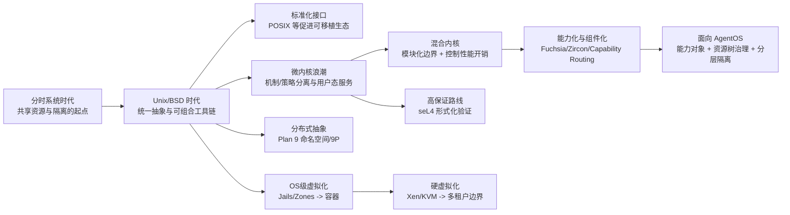
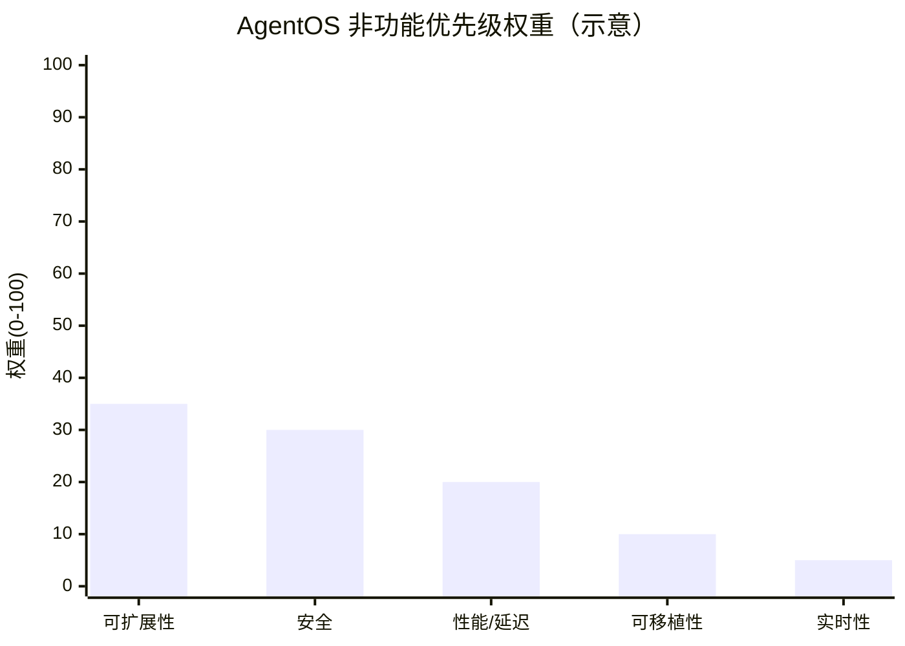
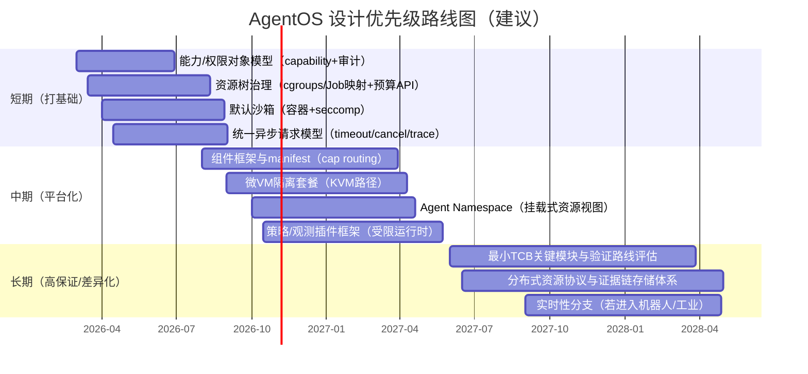

# 现代操作系统发展史与 AgentOS 设计启发研究报告

## 执行摘要

现代操作系统（OS）的演进并非“从单体到微内核”的线性故事，而是围绕三条长期张力反复摆动：**抽象统一与性能开销**、**灵活扩展与可信计算基（TCB）膨胀**、**开放生态与安全隔离**。从早期分时系统到 Unix 及其后继生态，再到 Windows NT、Darwin/XNU、BSD 系谱，乃至 Plan 9 的分布式命名空间与 Fuchsia/Zircon 的能力（capability）与组件化安全路由，主线规律在于：**当系统规模扩大、威胁模型升级或硬件形态变化时，OS 往往通过“更强的隔离边界 + 更可组合的资源命名/授权模型 + 更自动化的资源治理”来完成一次范式迁移**。（citeturn0search0turn9search2turn12search0turn17search3）

面向 AgentOS（此处按“通用智能体平台的系统软件栈”假设），这些历史经验可归纳为可落地的设计启发与优先级：

1. **最小权限与“默认拒绝”应成为 AgentOS 的第一性原理**：通过能力化授权（capability/handle/权利集合）与可审计的授权路由，把“工具/数据/网络/算力”当作可分发、可撤销、可组合的能力，而不是依赖隐式全局权限。（citeturn13search1turn5search1turn12search0turn8search2）  
2. **资源治理要“层级化”**：把“Agent/任务/子任务/工具进程”组织成资源树（类似 cgroups、Windows Job Objects、Zircon Jobs），在 CPU/内存/IO/网络等维度实现硬约束与隔离，并为多租户与可控 SLO 提供基础。（citeturn3search1turn4search2turn17search0turn17search1turn17search5）  
3. **隔离机制采用“分层防御”而非押注单一内核形态**：短中期以容器（namespaces+cgroups）+ 系统调用过滤（seccomp）作为默认沙箱；对高风险、不信任代码或强合规场景，再引入硬隔离（虚拟化/微 VM，如 KVM、Xen）。长期若要自研内核，优先把 TCB 缩到可验证的核心（seL4/微内核经验）。（citeturn4search0turn4search1turn13search9turn2search2）  
4. **“命名空间即架构”**：Plan 9 的私有命名空间、资源即文件（9P/Styx）与 Windows NT 的对象命名空间都证明：统一命名与访问路径能显著降低系统组合复杂度，并提升跨机/跨组件的一致性心智模型。（citeturn17search3turn0search2turn8search3turn11search11）  
5. **AgentOS 的“操作系统化”更可能首先发生在用户态与平台层**：以组件框架（manifest + capability routing + runner）构建安全、可更新、可组合的“智能体组件生态”，再逐步下沉到内核/虚拟化层做硬隔离与强保证。（citeturn8search6turn12search4turn12search0）

## 研究范围与未指定假设

本报告以操作系统史与关键架构要素为主线，结合原始论文、项目官方文档与权威书籍/节选（例如 Windows Internals 的公开节选、Pearson/IEEE 页面），输出对 AgentOS 的可迁移启发与可行性评估。（citeturn0search0turn2search0turn7search23turn16view1turn10search2）

**用户未指定且本报告必须明确的假设如下（并给出可替换策略）：**

- **目标硬件平台（未指定）**：默认假设 AgentOS 首要运行在“通用计算平台”上（云端与本地服务器的 x86_64/ARM64），并兼顾部分边缘设备；原因是智能体平台通常需要弹性扩展与 heterogeneous 部署。若你实际目标是嵌入式/机器人等强实时平台，应把实时性/确定性与安全认证（如 DO-178C、IEC 61508 类）提前到最高优先级，并可能直接借鉴 RTOS 或经认证内核路线。（citeturn5search0turn5search4）
- **主要应用场景（未指定）**：默认假设为“通用智能体平台”，包含多租户 agent 托管、工具插件执行、网络访问、长时运行任务、任务分解与分布式协作等。若场景偏单机个人助理，应更强调本地隐私与可解释审计；若偏企业代理，应更强调合规、隔离、可观测与供应链安全。（citeturn12search0turn13search1）
- **性能/安全/可扩展性优先级（未指定）**：本报告采用 **可扩展性优先，其次安全，再次性能** 的排序；理由是多 agent、多任务、多租户是平台型 AgentOS 的核心挑战，而安全通常是扩展后最先失控的维度。  
  - **可替换策略**：若你将“性能/低延迟”置顶（如低延迟交互 agent、自治系统控制环），路线图应把异步 IO、调度与资源隔离的开销控制放在前期，并慎用跨地址空间 IPC；若把“安全”置顶（强对抗与合规），应优先 capability 化、强沙箱（微 VM）、最小 TCB 与可验证模块。（citeturn8search1turn4search1turn2search2turn13search9）

在历史叙述中，涉及早期分时系统与 Unix 起源时，将在组织层面提及 entity["organization","MIT","university, Cambridge, MA, US"]、entity["organization","Bell Labs","research lab, Murray Hill, NJ, US"]、entity["organization","Carnegie Mellon University","university, Pittsburgh, PA, US"]、entity["organization","IEEE","standards org, US"] 与 entity["organization","IETF","standards org, global"] 等关键机构；在现代平台 OS 讨论中将涉及 entity["company","Microsoft","software company, US"]、entity["company","Apple","consumer electronics company, US"]、entity["company","Google","technology company, US"] 与 entity["company","Wind River","embedded software company, US"] 等。（citeturn10search1turn2search0turn10search2turn9search0turn5search0）

## 发展史时间线里程碑

下表按年代列出“现代 OS 演进”中对架构范式影响最大的节点（并非穷尽列表）。其选择标准是：**改变了资源抽象方式、隔离边界、可移植性/可扩展性路径或安全模型**。（citeturn9search2turn2search0turn4search0turn12search0）

### 里程碑时间线表

| 年代 | 系统/方向 | 关键创新 | 影响 |
|---|---|---|---|
| 1960s | CTSS / Multics | 分时与多用户交互、早期系统化的保护与隔离思路；Multics 的环（rings）与 ACL 等安全机制 | 把“多用户共享计算资源 + 隔离保护”变成 OS 的核心命题，为后续 Unix 与安全设计原则奠基。（citeturn10search1turn11search4turn11search9） |
| 1970s | Unix 早期 | 分层文件系统、统一的文件/设备/进程 IO 观、异步进程、以小而可组合的工具链为中心的用户态生态 | 形成“简单抽象可组合”的设计范式，影响后续几乎所有通用 OS 与开发文化。（citeturn0search0turn9search2） |
| 1980s | BSD 4.2/4.3 系谱 | FFS（性能导向的 on-disk 组织）、sockets/网络栈工程化普及 | 让“文件系统性能工程”和“网络 API 标准化（socket）”成为通用 OS 的标配。（citeturn1search5turn3search0） |
| 1988–1990s | POSIX 标准化 | 系统调用与用户态接口的可移植标准框架（起点常以 IEEE 1003.1-1988 标识） | 促进 Unix-like 生态兼容与应用可移植性，形成“接口层稳定、内部可演进”的治理模式。（citeturn10search2turn10search14turn10search10） |
| 1985–1990s | Mach（微内核浪潮） | 把 task/thread 与 IPC/port 作为核心对象；内存对象与 IPC 的耦合（分布式/并行动机） | 微内核思想扩散到后续混合内核与用户态服务切分（包括 Darwin/XNU 等）。（citeturn2search0turn18search3turn18search18） |
| 1993– | Windows NT | “修改的微内核/混合内核”思路、HAL 硬件抽象、对象管理与内核态安全组件、异步 I/O 模型 | 把可移植性、可扩展性、安全性作为商用通用 OS 的体系化目标，形成与 Unix-like 不同的对象/IO/安全风格。（citeturn6search0turn6search1turn5search3turn12search6） |
| 1992–1995 | Plan 9 | 每进程私有命名空间、资源以文件呈现、9P 协议的网络透明资源访问 | 给分布式系统提供了“统一命名 + 协议化资源”的 OS 级答案，是后续“命名空间/组件化/远程资源即本地”的重要先驱。（citeturn0search2turn17search3turn8search3） |
| 1995 | Exokernel | 将“保护（protection）与管理策略（management/policy）”分离，内核只做安全复用与资源导出 | 预示了云时代“平台抽象下沉、策略上移”的趋势，对可插拔策略与多运行时并存有启发。（citeturn8search0） |
| 1996–2000s | L4 家族与微内核性能回潮 | 证明微内核 IPC 可以很快；强调最小性与关键路径优化，并推动可验证内核方向 | 使“微内核=慢”不再是必然，为高保证系统与可信 TCB 缩小提供路径。（citeturn8search1turn2search2） |
| 2000 | FreeBSD Jails | 在保留 Unix 模型下实现 OS 级虚拟化（比 chroot 更强的隔离），默认让 jailed root 失去特权 | 为容器化提供了早期成熟范式：共享内核但强隔离、面向多租户部署。（citeturn3search2） |
| 2003–2007 | Xen / KVM | 服务器虚拟化：Xen 强调隔离与资源控制；KVM 将硬件虚拟化扩展融入 Linux | 让“硬隔离（VM）”成为云与多租户的基本构件，并与容器形成分层组合。（citeturn4search0turn4search1turn2search3） |
| 2004 | Solaris Zones | 生产级 OS 内建的轻量虚拟化与服务器整合能力 | 强化“分区（partition）+ 资源治理”作为 OS 一等能力的路径。（citeturn3search7） |
| 2009 | seL4 形式化验证 | 对微内核实现进行机器辅助证明，强调可验证设计与最小 TCB | 把“可证明安全/正确性”从理论推进到可部署路线，影响高安全系统设计思维。（citeturn2search2） |
| 2010 | Capsicum | 在 Unix API 上增量引入 capability mode 与能力化 FD，支持应用分舱（compartmentalization） | 为“在既有生态上逐步能力化”提供实践模板，特别适合从平台层渐进式演进。（citeturn5search1） |
| 2013–2015 | Docker / cgroups v2 / namespaces 实践成熟 | Docker 工具链推动容器成为主流打包与交付方式；cgroups v2 给出更统一的资源控制接口；namespaces 提供隔离原语 | 让“可移植交付 + 资源隔离 + 多租户治理”成为云原生默认范式。（citeturn10search7turn3search1turn4search2） |
| 2016–2025 | Fuchsia / Zircon / 组件框架 | capability-based 内核对象与 handle 权利；组件声明式能力路由；默认进程隔离 | 将“组件化 + 最小权限 + 可更新性”提升到 OS 设计原则层，特别贴近 AgentOS 的插件生态与安全需求。（citeturn12search0turn8search2turn12search1turn17search1） |

**对 AgentOS 的直接启示**：时间线显示，真正改变生态的往往不是单个“更快的调度算法”，而是**资源抽象与授权方式**（Unix/Plan 9/Fuchsia）、**隔离边界工程化**（Jails/Zones/VM/容器）、以及**可移植接口与组件化治理**（POSIX、组件框架）。（citeturn0search0turn17search3turn12search0turn3search2）

## 关键设计原则与架构演进综述

本节按你指定的要素框架梳理“从现代 OS 学到什么”，并对 AgentOS 做逐项映射。这里的“原则”并非口号，而是被反复验证的工程约束：越靠近内核与共享资源，越需简化与可验证；越靠近应用与策略，越需可组合与可演进。（citeturn13search1turn8search0turn12search4）

### 内核类型与系统结构

- **单体内核（monolithic）**以 Unix/Linux 为代表：内核把进程、内存、文件系统、驱动等集中在单一特权域，优点是调用路径短、共享状态方便，风险是 TCB 膨胀与故障/漏洞影响面大；Unix 早期强调“统一 IO 抽象 + 可组合用户态工具”而非高隔离。（citeturn0search0turn9search2）
- **微内核（microkernel）**以 Mach、L4、MINIX 3、seL4 等为代表：把最基本机制（调度、地址空间、IPC 等）留在内核，其余（驱动、文件系统、网络栈）移到用户态服务器。Mach 以 port/消息作为对象操作方式；L4 体系与后续研究强调最小性与 IPC 性能；seL4 进一步把“可验证”作为设计目标。（citeturn2search0turn8search1turn2search2turn2search1）
- **混合/修改式微内核（hybrid/modified microkernel）**以 Windows NT 与 XNU（Darwin 内核）为代表：保留模块化边界与部分微内核思想，但在内核态内聚合更多服务以控制性能成本。XNU 明确是 Mach + FreeBSD 组件 + IOKit 驱动框架的混合；Windows NT 也通过 HAL、Executive 等模块化实现可移植与扩展。（citeturn1search3turn1search15turn6search0turn12search6）
- **能力化对象内核 + 组件框架**以 Zircon/Fuchsia 为代表：它在“微内核式架构”与“减少信任代码量”的动机下，不追求极致最小，而强调默认隔离、handle/权利驱动的能力化访问，以及组件间 capability routing。（citeturn12search4turn12search0turn8search2turn17search17）
- **Exokernel**提供另一条思路：将资源保护与策略分离，内核以低层安全原语导出硬件资源，策略由库 OS/用户态实现，最大化灵活性。（citeturn8search0）

**对 AgentOS 的启示**：AgentOS 的关键不是“选一个宗派内核”，而是明确哪些能力必须进入 TCB。通常可把 TCB 划成三层：  
1) **硬隔离层**（VM/内核机制，最小、稳定、可审计）；2) **沙箱与资源治理层**（容器、seccomp、cgroups、作业/配额树）；3) **策略与编排层**（agent 运行时、工具路由、权限声明、审计与可观测）。历史经验显示：从平台层先建立清晰的“能力/资源模型”，往往比立刻自研新内核更能降低整体风险。（citeturn4search1turn3search1turn13search9turn12search0）

### 进程/线程模型与调度

- **Unix 的 fork/exec/wait 进程模型**塑造了后续进程控制与组合方式：父子进程与文件描述符继承使管道/重定向成为强组合工具；但现代研究也指出 fork 的历史负担会在大型地址空间与安全隔离场景下放大成本。（citeturn18search2turn18search9turn0search0）
- **线程模型**在多核时代成为标配：Linux 通过 clone 机制让线程共享地址空间与部分执行上下文；Windows 的线程状态机与多处理器调度数据库体现出“可扩展调度数据结构”的工程化取舍（如 per-processor ready queue/组队列思路）。（citeturn18search1turn16view1）
- **Mach 的 task/thread/port**把“可操控对象”与 IPC 绑定：创建任务/线程返回对 port 的访问权利，通过消息调用操作对象。这种“对象句柄 + 权利”思想与后来的 Zircon handles、Windows 对象/句柄在精神上相通。（citeturn18search3turn12search1turn9search23）
- **实时 OS（以 VxWorks 为例）**强调确定性：优先级抢占与可选轮转、较多优先级等级、并强调可预测行为，是“物理世界闭环”场景的典型路线。（citeturn5search4turn5search0）

**对 AgentOS 的启示**：AgentOS 的调度不仅是 CPU 时间片，更是“**模型推理、工具调用、网络 IO、长任务编排**”的混合调度。建议借鉴 OS 调度的两个历史经验：  
- **把可抢占的“执行”与不可抢占的“外部等待”分开建模**（类似线程的 running/waiting/ready 状态机），并把工具调用统一成异步事件流；  
- **为资源树提供统一的配额与优先级继承/限制机制**（参考 cgroups/Job Objects/Zircon Jobs），使 agent 在多租户下仍可控。（citeturn16view1turn3search1turn17search0turn17search5）

### 内存管理演进与隔离

- Mach 将内存对象与 IPC/port 联系起来，允许通过消息请求分页等操作，并强调可分布式扩展的动机。（citeturn18search10turn18search18）
- 微内核与高保证路线通常依赖更清晰的地址空间/能力边界；seL4 的工作展示了在严格假设下对内核实现进行形式化验证的可行性，前提是接口小、设计可证明。（citeturn2search2）
- 在工程实践中，Windows 的作业对象（Job Objects）可对相关进程组施加工作集、优先级、时间等限制，这体现出“把资源限额作为一等对象”对系统稳定性的价值。（citeturn17search0turn17search4）

**对 AgentOS 的启示**：智能体平台的核心风险之一是“不可预期的内存增长/泄漏/提示注入导致的上下文膨胀”。因此内存管理启发更偏“治理”而非传统分页算法：  
- 在宿主 OS 层用 cgroups/Job Objects 实施硬内存上限与 OOM 策略；  
- 在 AgentOS 层把“上下文/长记忆/向量索引/缓存”纳入统一配额与回收机制，使其像文件系统配额一样可审计、可限制。（citeturn3search1turn17search0turn6search2）

### 文件系统与持久化抽象

- Unix 早期的层次文件系统与“文件/设备/进程 IO 兼容”的抽象，奠定了“以统一接口覆盖多类资源”的路线。（citeturn0search0）
- BSD 的 FFS 通过改变磁盘布局与块策略显著改善性能，体现出“抽象之下仍要面向介质特性做系统级性能工程”。（citeturn1search5）
- 现代文件系统（以 Apple 的 APFS 为例）把加密、写时复制（COW）元数据、快照、克隆与空间共享等作为关键能力，反映出“可靠性、可回滚、隐私安全”成为主轴。（citeturn6search3turn6search7）
- Plan 9/Inferno 的思路更激进：把资源统一呈现为文件，并用 9P/Styx 在网络上传输这种文件语义，实现“远程资源像本地文件一样被挂载到命名空间”。（citeturn8search3turn17search3turn0search2）

**对 AgentOS 的启示**：AgentOS 的“文件系统问题”本质是“**记忆与证据链（provenance）**”。可借鉴两条思路：  
- 借鉴 APFS 的快照/原子性与加密思路，为 agent 的状态（任务图、工具输出、检索索引）提供可回滚与可审计的版本化存储语义；  
- 借鉴 Plan 9 的“把远程资源挂载进命名空间”，把外部工具/数据源抽象为可挂载资源（例如把数据库、搜索、文件库、模型服务以统一协议暴露），从而简化跨环境部署。（citeturn6search3turn17search3turn8search3）

### 驱动与硬件抽象

- Windows NT 通过 HAL 抽象硬件差异，并在 I/O 模型上强调一致接口与异步 I/O；I/O Manager 以 IRP 作为请求封装，把驱动链式处理标准化。（citeturn6search0turn6search1turn6search5）
- Darwin/XNU 将内核划分为 Mach、BSD 与 I/O Kit 等组件，体现出“内核内部也要模块化以支撑可演进驱动生态”。（citeturn1search3turn1search15）
- MINIX 3 把大量服务放在用户态服务器中，并强调小内核与可维护性、可恢复性（驱动崩溃不必拖垮系统）。（citeturn2search1turn2search9）

**对 AgentOS 的启示**：AgentOS 的“驱动”更像“工具插件/连接器/执行器（runner）”。因此应把 OS 的驱动经验迁移为：  
- **插件必须可隔离、可重启、可回收**（借鉴用户态驱动/服务器）；  
- **统一 I/O 请求模型**（类似 IRP/异步 I/O），将工具调用、文件访问、网络请求统一表述为可观测、可取消、可限额的请求对象。（citeturn6search1turn2search1）

### 安全与权限

- Saltzer 与 Schroeder 的经典总结强调安全机制的设计原则（如最小权限、经济机制、默认拒绝等），此类原则在几十年后仍是 OS 安全工程的“共识基线”。（citeturn13search1）
- Multics 的保护环与 ACL 机制展示了“硬件/内核支持的分级隔离 + 细粒度访问控制”可以成为系统性能力，而不只是应用层约定。（citeturn11search4turn11search9turn11search1）
- Windows 的 Security Reference Monitor 在内核架构中扮演强制访问控制的核心执行者角色，强调“每次对象访问都必须被验证”的强制点。（citeturn5search3）
- Capsicum 展示了在传统 Unix API 上以增量方式引入 capability mode 与能力对象，从而支持应用分舱，这是“渐进式能力化”的重要工程范例。（citeturn5search1）
- Fuchsia 明确把 Zircon 定义为 capability-based 内核，并强调默认隔离、通过 handle 传递能力而非通过名字隐式获取资源；组件通过 capabilities 获得权限。（citeturn12search0turn8search2turn12search1）

**对 AgentOS 的启示**：AgentOS 的权限不是传统“读/写文件”，而是“能否调用某个外部工具、能否访问某类数据、能否发起外网请求、能否把信息写出到某个渠道”。历史经验强烈支持两点：  
1) **把权限做成显式可组合对象（capability/handle + rights）**，默认不给任何出网/写入/执行权限；  
2) **把授权路径做成声明式可审计的路由图**（类似 Fuchsia capability routing），并强制所有敏感操作经过统一的审计点（可类比 SRM 的强制执行位置）。  
可替代方案是传统 ACL/RBAC，但在高度动态的 agent-to-tool 关系下，纯 ACL 往往会退化为难以维护的策略表，而 capability 模型更易做“按需分发、最小化、可撤销”。（citeturn12search0turn8search2turn5search3turn5search1）

### 网络与分布式支持

- TCP 与 UDP 的标准化（RFC 793/768）为通用 OS 的网络能力奠定基础，并形成“协议层可演进但接口需稳定”的长期工程范式。（citeturn9search0turn9search1）
- BSD sockets 的成熟使网络编程接口成为跨系统的事实标准之一。（citeturn3search0）
- Plan 9 通过 9P/命名空间把分布式资源访问纳入 OS 的基本抽象：资源以文件呈现，可被挂载到进程私有命名空间中。（citeturn17search3turn0search2turn8search3）

**对 AgentOS 的启示**：分布式对 AgentOS 属于默认场景（多 agent、跨节点工具、远程模型与数据源）。Plan 9 的核心价值在于：让“分布式”像“本地”一样被编程与组合。对 AgentOS 可迁移为：为每个 agent 提供**私有资源视图（namespace）**，将远程工具与数据源以统一挂载机制呈现，从而减少“每个插件各自定义认证/路由”的碎片化。（citeturn17search3turn8search3）

### 容器/虚拟化与可观测扩展

- Linux namespaces 提供“把全局资源包装成隔离实例”的机制，是容器实现的基础；cgroups v2 则提供资源控制的统一接口与约定。（citeturn4search2turn3search1）
- FreeBSD Jails 和 Solaris Zones 代表了较早的 OS 级虚拟化/分区实践，强调多租户隔离与易部署。（citeturn3search2turn3search7）
- Xen 与 KVM 显示虚拟化可作为更强隔离边界：Xen 强调安全与资源控制；KVM 借助硬件扩展把 VM 作为 Linux 子系统融入。（citeturn4search0turn4search1turn2search3）
- seccomp 与 eBPF 展示了“在不改内核/不装新模块的前提下，用受限程序扩展/限制系统行为与可观测性”的路线：seccomp 过滤系统调用，eBPF 作为内核中的沙箱运行时用于扩展与观测。（citeturn13search9turn4search11）

**对 AgentOS 的启示**：  
- **容器**适合作为“默认沙箱”，用于工具执行、第三方插件、用户提供代码等；  
- **VM/微 VM**适合作为“高风险隔离层”，在多租户强对抗中提供更强边界；  
- **seccomp/eBPF**分别对应“最小系统调用面”与“高可观测/可策略化扩展”。对 AgentOS 来说，这意味着可以把“工具运行时”做成可插拔 runner，并用系统级机制限制其能力、观测其行为、记录证据链。（citeturn13search9turn4search1turn4search11）

### 实时性与确定性

实时 OS（以 VxWorks 的文档描述为例）强调优先级抢占与大量优先级等级、可选轮转等机制，以支持可预测调度。（citeturn5search4turn5search0）  
对通用 AgentOS，实时性通常不是第一阶段要求；但一旦进入机器人、工业控制、金融风控等“时间约束是正确性的一部分”的场景，就需要把“确定性（determinism）”单列为目标：可复现的调度与 IO 行为、可回放的执行轨迹、明确的超时/降级策略。

### 架构演进流程图（概念视图）

## 特性对 AgentOS 的具体启发与可行性评估

本节将“现代 OS 的关键特性”映射为 AgentOS 的具体启发，并给出：优点、风险、实现难点与替代方案。为便于产品路线决策，先给出对比表，再对关键项做扩展解释。（citeturn12search0turn5search1turn3search1turn4search1turn2search2）

### 特性对 AgentOS 启发对比表

| 特性 | 对 AgentOS 的启发 | 实现难点（风险点） | 优先级（建议） |
|---|---|---|---|
| 能力（capability）安全与最小权限 | 将“工具调用/数据访问/出网/写入”等做成 capability token + rights；默认无权，按需授予 | 能力传播与撤销、调试可用性、避免“隐式全局权限”回流 | P0 |
| 声明式能力路由与组件化（Fuchsia 风格） | 用 manifest 描述组件需求与输出能力；实现可审计的 capability routing graph | 设计路由语义、版本兼容、路径爆炸（策略复杂度） | P1 |
| 资源树治理（cgroups/Job/Zircon jobs） | 为 agent/任务树统一施加 CPU/内存/IO/网络配额与优先级，支撑多租户与 SLO | 资源度量与归因、跨平台适配（Linux/Windows/macOS）、避免“配额抖动” | P0 |
| 容器隔离（namespaces + cgroups） | 默认运行工具/插件于容器沙箱；按风险分级隔离策略 | 容器逃逸风险仍在、内核共享导致同内核攻击面；需要 seccomp/LSM 配合 | P0 |
| 系统调用面收缩（seccomp） | 对工具 runner 限制 syscalls，降低攻击面；把“可调用系统能力”变成策略 | 策略维护成本、兼容性（不同工具需求差异大） | P0 |
| 硬虚拟化（KVM/Xen） | 为不信任代码/强对抗租户提供硬隔离；可作为“高风险执行层” | 成本与冷启动、设备访问/网络复杂性、运维复杂度 | P1 |
| 微内核/最小 TCB + 用户态服务 | 将高风险服务（驱动/网络/文件）移出 TCB；工具/插件天然用户态服务化 | IPC 性能与工程复杂度；生态迁移成本高 | P2 |
| 可验证内核/形式化方法（seL4） | 将最核心安全决策点缩小到可证明模块；用于高安全级 AgentOS 版本 | 人力与专业门槛高；需求变动会推高证明成本 | P2 |
| 统一命名空间（Plan 9/对象命名空间） | 为 agent 提供私有 namespace；把远程工具/数据“挂载”为统一资源路径 | 语义设计困难（文件语义 vs RPC 语义）、权限/身份映射 | P1 |
| “资源即文件/协议化资源”（9P/Styx） | 用统一协议表示“工具/数据/模型”资源，减少 SDK 碎片化 | 性能与语义不匹配；需要清晰的错误/超时/幂等模型 | P2 |
| 异步 I/O 与请求对象模型（Windows I/O） | 将工具调用统一为可取消、可重试、可观测的异步请求；便于调度与背压 | 需要端到端的 tracing 与超时规范；对开发者心智要求高 | P0 |
| 可观测与可插拔扩展（eBPF 思路） | 用受限程序做策略/观测扩展：审计、限速、检测异常行为 | 安全边界与验证器设计；跨平台能力差异 | P1 |
| 实时性与确定性（RTOS） | 在机器人/工业场景提供确定性调度与超时保证 | 与通用吞吐目标冲突；需要严格优先级与资源预留 | 可选分支 |

**优先级口径**：P0=短期必须（支撑平台安全与可扩展基本盘）；P1=中期增强（提高模块化、安全纵深与运维能力）；P2=长期战略/差异化（高保证或新内核形态）。

### 关键特性深入评估（面向实现决策）

**能力化安全（capability）为什么应被定为 P0**  
从 Multics 到 Saltzer/Schroeder 的原则，再到 Capsicum 与 Fuchsia，核心共识是：系统应避免“环境中天然存在的全局权力（ambient authority）”，改用显式可传递、可限制的能力对象。（citeturn11search9turn13search1turn5search1turn12search0）  
对 AgentOS，这对应“工具访问默认关闭、按任务最小授权”。优点是权限最小化、可审计性强、便于做多租户隔离；风险在于复杂度向“权限路由图”和“能力生命周期管理”集中，需要通过 manifest、能力路由可视化与调试工具来压复杂度。

**资源树治理为什么应与能力化并列为 P0**  
Linux cgroups 的层级资源控制、Windows Job Objects 对进程组的限制、Zircon Jobs 的树形结构都表明：对复杂系统而言，“把资源限制建模为层级对象”能显著提升系统稳定性与治理能力。（citeturn3search1turn17search0turn17search5turn17search1）  
对 AgentOS，建议将“agent 会话/任务 DAG/子任务/工具进程”映射到资源树节点，并提供统一的**预算（budget）**概念：token（推理预算）、CPU、内存、并发连接数、外网带宽、写入速率等，支撑产品层面的成本控制与可靠性 SLO。

**容器 + seccomp +（可选）VM 的分层隔离**  
namespaces 提供隔离语义、cgroups 提供资源，seccomp 收缩系统调用面，是当前最现实的“默认沙箱三件套”；而 Xen/KVM 等虚拟化提供更强硬边界，可用于高风险执行层。（citeturn4search2turn3search1turn13search9turn4search1turn4search0）  
对 AgentOS 的可行性判断：  
- **短期**：以容器+seccomp 作为默认工具运行时，满足大多数插件生态；  
- **中期**：针对不信任租户/代码与强合规场景，引入微 VM；  
- **长期**：若要进一步缩 TCB，则评估微内核/高保证路线。

**统一命名空间：从 OS 工程抽象到 AgentOS 资源抽象**  
Plan 9 的“每进程私有命名空间”表明：系统资源的组织方式决定了组合方式；Windows 的对象命名空间则展示了另一种“统一对象目录树”以支撑系统组件协作。（citeturn17search3turn0search2turn11search11）  
对 AgentOS，可以把“工具/数据源/模型端点/凭据代理”等都挂载到 agent 私有 namespace 下：不同 agent 的资源视图天然隔离，权限变成“能否把某能力挂载进你的 namespace”。

### 优先级权重示意图（主观评分）

下图仅用于表达本报告采用的“可扩展性与安全优先”的权重假设（可按你的实际目标替换）。

## 实际案例研究与对 AgentOS 的可借鉴点

本节选取 5 个系统（满足“至少 3 个 OS”的要求），覆盖 Unix/Linux 传统、Windows NT 工程化风格、Darwin/XNU 混合内核、Plan 9 分布式抽象、Fuchsia 能力化组件路线。每个案例都落脚到“对 AgentOS 的可迁移机制”，并指出局限。（citeturn0search0turn12search6turn1search15turn0search2turn12search0）

### 案例系统对比表

| 系统 | 架构类型（概括） | 适用场景（典型） | 可借鉴点（对 AgentOS） | 限制/代价 |
|---|---|---|---|---|
| Unix/Linux | 单体内核为主，用户态强组合工具链 | 通用服务器/桌面/云 | “统一抽象 + 可组合管道”、容器原语（namespaces/cgroups）、seccomp 过滤 | 内核共享导致隔离上限；安全策略碎片化需要平台层统一（citeturn0search0turn4search2turn3search1turn13search9） |
| Windows NT | 混合/修改式微内核；HAL；对象/句柄；异步 I/O | 企业桌面/服务器，异构硬件 | HAL 抽象、I/O 请求对象化（IRP）、安全 SRM、Job Objects 资源治理、可扩展调度结构 | 模型复杂、接口与内部机制学习成本高；闭源生态限制可移植实验（citeturn6search0turn6search1turn5search3turn17search0turn16view1） |
| Darwin/macOS（XNU） | 混合内核：Mach + BSD + IOKit | 桌面/移动生态 | 混合内核分层、驱动框架化（IOKit）、在保留 Unix API 下演进内部结构 | 强绑定平台生态；内核扩展与安全机制依赖厂商治理（citeturn1search3turn1search15） |
| Plan 9 | 分布式 OS 抽象：私有命名空间 + 9P | 研究/分布式抽象探索 | “命名空间即架构”、远程资源挂载为本地统一路径、资源即文件/协议化访问 | 生态与性能/兼容性限制使其难以成为主流通用 OS（citeturn0search2turn17search3turn8search3） |
| Fuchsia（Zircon + 组件框架） | capability-based 对象内核；组件化能力路由 | 安全与可更新性优先的通用 OS 探索 | 默认进程隔离、handle+rights、capability routing、Job 树治理；适合作为 AgentOS 插件生态蓝图 | 生态尚在演进；引入新平台的迁移成本高（citeturn12search0turn8search2turn17search1turn12search1） |

### 案例要点提炼

**Unix/Linux：抽象统一与组合性如何迁移到 AgentOS**  
Unix 论文强调层级文件系统、兼容 I/O、异步进程等特性，并以用户态工具链与可组合接口形成强生态。（citeturn0search0turn9search2）  
对 AgentOS 的迁移不应停留在“像 shell 一样写 pipeline”，而是把组合思想升级为：**把 agent 的每一次外部交互建模为可组合的请求/流**，并借助容器与资源控制把组合的代价限制在安全边界内。（citeturn4search2turn3search1）

**Windows NT：把“治理能力”内建到内核/系统服务的工程化风格**  
Windows 的 HAL 明确承担硬件差异抽象；I/O 模型强调异步与统一请求封装；SRM 作为内核安全架构核心执行者；Job Objects 为进程组提供资源限制；调度结构体现多处理器可扩展性工程。（citeturn6search0turn6search1turn5search3turn17search0turn16view1）  
对 AgentOS 的启发是“平台治理一等化”：不要把审计、限流、资源配额当作业务逻辑散落在各处，而要像 SRM/Job 那样把**强制点与资源树**做成平台核心能力。

**Darwin/XNU：混合内核作为“兼容与演进”的折中路径**  
Apple 的内核结构概述与 XNU 仓库说明其由 Mach 与 FreeBSD 组件及 IOKit 组合而成，体现出在保留既有生态（Unix API）下通过内部结构切分实现演进。（citeturn1search3turn1search15）  
对 AgentOS：若你希望快速落地生态，应优先在“接口层稳定”的前提下演进内部机制（例如保持通用 POSIX/容器运行时能力，同时在 AgentOS 层做能力路由与审计），而非早期强推不兼容的新编程模型。（citeturn10search2turn12search0）

**Plan 9：分布式系统的“统一命名解法”**  
Plan 9 的私有命名空间与 9P/Styx 协议让远程资源可被挂载并以文件呈现，这是把分布式复杂性内化到 OS 抽象层的代表。（citeturn17search3turn8search3turn0search2）  
对 AgentOS：最值得学习的是“**每个 agent 有自己的世界观（namespace）**”。这直接对应多租户场景：同一套工具能力可被不同 agent 以不同挂载方式呈现，从而把权限控制与依赖注入变得可视化、可审计。

**Fuchsia：能力化与组件框架对“插件型 Agent 平台”的适配性**  
Fuchsia 的安全原则明确：Zircon 是 capability-based、默认进程隔离，资源通过 handle 作为能力传递；组件通过 capabilities 交互；Zircon 的 Job/Process/Thread 对象形成树状资源治理结构。（citeturn12search0turn8search2turn17search1turn17search5）  
对 AgentOS：这几乎可以直接映射为“agent 组件框架”：  
- 组件=工具/模型适配器/记忆库/审计器/策略引擎；  
- capability=访问某个数据源/模型端点/网络域/写入通道的权利；  
- job tree=agent 任务树与预算树；  
- runner=执行环境（容器、微 VM、受限解释器等）。  
这条路线的主要风险是体系复杂度，需要配套的可视化与调试工具，否则策略与能力路由会迅速变得不可维护。（citeturn8search6turn12search1turn17search5）

## 面向 AgentOS 的设计建议与优先级路线图

本节给出“短-中-长期”建议，并明确每阶段的目标产物与风险控制点。核心策略是：**先在现有 OS 上实现 AgentOS 的能力模型与治理平面，再逐步增强隔离与保证**。（citeturn5search1turn3search1turn4search1turn12search0）

### 短期建议

短期目标是建立 AgentOS 的“可扩展 + 安全”基本盘：能力模型、资源治理、默认沙箱与可观测。

1) **定义 AgentOS 的能力与资源对象模型**  
将工具、数据源、网络域、写入通道、密钥代理等统一建模为 capability（token/handle + rights）。默认拒绝，按任务最小授权；并强制所有能力授予/转授经过统一审计点。（citeturn13search1turn12search0turn8search2turn5search3）

2) **建立层级化资源树（agent/job/task）与预算系统**  
直接利用宿主 OS 的 cgroups（Linux）或 Job Objects（Windows）执行硬限制；在 AgentOS 层建立跨运行时统一的“预算 API”（CPU、内存、并发、出网速率、token 等）。这一步是后续多租户与成本治理的底座。（citeturn3search1turn17search0turn17search2）

3) **默认工具执行沙箱：容器 + seccomp（并预留 VM 分支）**  
把第三方插件、用户代码、爬虫/解析器、非确定性工具放入容器；用 seccomp profile 把系统调用面最小化；对高风险租户预留微 VM（KVM）执行路径作为“高隔离套餐”。（citeturn4search2turn13search9turn4search1）

4) **统一异步 I/O 与请求对象：可取消、可重试、可追踪**  
借鉴 Windows I/O 模型对异步的强调，把 tool-call 统一成 request 对象，具备 timeout、cancel、retry、backoff、trace id。这样调度与背压才能体系化地工作。（citeturn6search1turn16view1）

### 中期建议

中期目标是把 AgentOS 从“运行时+策略”提升为“组件化平台”：可组合、可更新、可治理。

1) **引入组件框架与声明式 manifest**  
参考 Fuchsia 组件能力的思想：组件声明“需要的能力”和“提供的能力”，平台做 capability routing 并生成可审计图；同时引入版本化与兼容策略，防止插件生态碎片化。（citeturn8search6turn8search2turn12search0）

2) **多层隔离产品化：容器为默认、微 VM 为高安全域**  
以 Xen/KVM 路线的经验为依据，对“强对抗/高合规”提供硬隔离套餐。关键是把隔离策略产品化（可配置、可观测、可计费），而非一次性工程项目。（citeturn4search0turn4search1turn2search3）

3) **统一命名空间与资源挂载机制（Agent Namespace）**  
将工具与数据源挂载进 agent 私有 namespace，形成可视化的“我拥有什么能力/路径”。这一步能显著降低权限与依赖注入的认知成本，并为分布式执行打基础。（citeturn17search3turn11search11turn8search3）

4) **策略与观测的可插拔扩展**  
借鉴 eBPF “受限程序+验证+挂载点”的思想，在 AgentOS 层提供“策略插件/审计插件”的受限运行环境（不必进入内核），实现动态限速、异常检测与合规策略快速迭代。（citeturn4search11turn12search0）

### 长期建议

长期目标是建立差异化壁垒：更小 TCB、更强保证、更强分布式一致性与（可选）实时确定性。

1) **关键安全内核最小化与可验证模块**  
如果 AgentOS 需要在强对抗环境下提供“可证明级保证”，应将最核心的安全决策与能力检查压缩到最小接口，并评估采用可验证内核/微内核经验（seL4 的路径证明其可行，但成本高且对需求稳定性敏感）。（citeturn2search2turn8search1）

2) **面向分布式的统一资源协议与“证据链存储”**  
在 Plan 9/9P 思想启发下，设计面向 agent 的资源协议（不必严格复刻文件语义），核心目标是：跨节点一致的能力授予、可迁移的资源挂载、可回放的执行轨迹与证据链。（citeturn8search3turn17search3）

3) **实时性分支（按需）**  
若进入机器人/工业控制，应引入 RTOS 风格调度与确定性保证，并把模型推理与感知/控制链路做隔离与优先级治理。（citeturn5search4turn5search0）

### 路线图（短中长期）

## 结论

现代操作系统的发展史反复验证了一条对 AgentOS 极其关键的规律：**当系统从单用户/单任务走向多租户、多组件、跨网络协作时，真正决定系统上限的是“权限与资源治理模型”而不是单点性能优化**。Unix 的可组合抽象、Windows NT 的治理工程化、Darwin 的兼容式演进、Plan 9 的命名空间分布式抽象、Fuchsia 的 capability + 组件路由共同指向：AgentOS 应优先构建 **capability-first 的权限体系**与**层级化资源树治理**，并用容器/seccomp/VM 形成分层隔离，再逐步平台化为组件生态；只有在强对抗或强认证需求明确时，才值得把路线下沉到微内核/可验证内核等长期高成本方向。（citeturn13search1turn5search1turn12search0turn3search1turn4search1turn2search2）