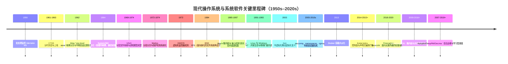
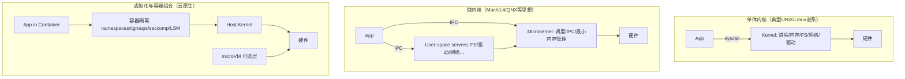

# 现代操作系统发展史与对AgentOS的启发

## 执行摘要

本报告回顾1950年代批处理监控程序起步、1960年代分时与虚拟内存成形、1970年代UNIX抽象与可移植性奠基、1980–90年代微内核与PC系统分化、以及2000年代以来虚拟化、容器与集群编排、移动与物联网、形式化验证与硬件能力安全的发展脉络。研究显示：操作系统演进的主线并非“内核形态之争”，而是围绕**抽象边界**（接口）、**隔离机制**（安全与故障域）、**可演进性**（模块化与升级回滚）不断重构。对AgentOS而言，最具启发的是：以声明式“期望状态+控制回路”实现自治与自愈；以分层调度与资源隔离承载多智能体并发；以能力化接口、强沙箱与可验证关键路径降低不可控风险；并以可观测性与可回滚升级支撑长期在线演进。  

## 研究范围与时间线

本报告将“现代操作系统”界定为：以**多任务并发**、**内存与资源虚拟化**、**安全隔离**和**可维护演进**为核心目标的软件系统（含内核、运行时、虚拟化层与集群控制面）。时间范围覆盖1950年代至今，阶段涵盖：批处理/分时系统、虚拟内存与多道程序、UNIX谱系与PC系统、微内核与实时OS、分布式OS、虚拟化与容器、移动与物联网OS，以及基于AI/自适应的资源管理与调度。关键史料优先取自经典论文、官方文档与权威机构资料（如entity["organization","ACM","computing society | ny, us"]/entity["organization","IEEE","engineering society | ny, us"]、官方内核/平台文档、USENIX论文与厂商白皮书）。citeturn5search20turn18view1turn19search2turn2search0turn20view3

上述节点分别来自早期批处理监控与史料整理、CTSS原始论文与纪念文档（含分时定义与实验细节）、Atlas虚拟内存里程碑介绍、entity["company","IBM","it company | armonk, ny, us"] System/360官方历史、UNIX与Multics经典论文、VM/370与Xen/VMware虚拟化论文、Linux容器隔离的namespaces/cgroups文档、Kubernetes官方架构与组件文档、Firecracker与学习型调度论文、以及seL4/CertiKOS的形式化验证成果。citeturn5search20turn18view0turn18view1turn5search1turn18view2turn19search2turn19search1turn2search0turn2search2turn9search2turn9search3turn20view3turn17search1turn12search0turn1search6turn17search0

## 关键里程碑与代表系统

下表按“阶段目标→代表系统/论文→关键创新→对AgentOS启发”串联操作系统史的主线：从“提高吞吐”走向“交互与并发”，再到“隔离与治理”，最终扩展到“自治与学习”。citeturn5search20turn18view1turn19search2turn2search0turn20view3turn12search0

| 阶段 | 时间 | 代表系统/论文（示例） | 关键创新与影响（高度概括） | 对AgentOS的直接启发 |
|---|---|---|---|---|
| 批处理监控与作业流 | 1950s | GM-NAA I/O（批处理监控）citeturn5search20turn5search0 | 将“运行下一个作业”自动化，形成早期“调度/队列/监控”雏形。citeturn5search20 | Agent任务队列、任务状态机、失败后自动推进的“作业控制语言化”接口。 |
| 分时与交互式计算 | 1960s | CTSS 分时系统论文与纪念文档citeturn18view1turn18view0 | 以时间片与交换支撑多人交互；强调“响应时间/人机效率”。citeturn18view1 | Agent交互型工作负载需以尾延迟为中心，而非仅吞吐；配套“饱和时优雅退化”。citeturn18view1 |
| 虚拟内存与多道程序 | 1962+ | Atlas 虚拟内存里程碑citeturn5search1 | “one-level store”、按需分页与置换策略（含早期“学习程序”思想）。citeturn5search1 | Agent长期运行必须把“记忆/上下文”当作可管理资源：分层存储、按需换入、策略可学习但要可控。citeturn5search1turn12search0 |
| 平台化与兼容生态 | 1964 | System/360（平台与兼容家族）citeturn18view2 | 通过兼容架构与软硬件解耦，使软件可复用、生态可扩张。citeturn18view2 | AgentOS应优先稳定“系统调用/能力接口/资源模型”，让上层Agent框架可演进而不被底层频繁破坏。 |
| 安全与共享的系统化 | 1970s | Multics 访问控制与共享控制论文；安全原则论文citeturn19search1turn6search0 | ACL、分层控制、认证与“最小权限”等原则；把安全作为体系结构问题。citeturn19search1turn6search0 | 多Agent本质是多租户：默认拒绝、最小权限、全链路审计应内建为“机制+流程”，不是事后加固。citeturn6search0turn13search0 |
| UNIX 抽象与可移植性 | 1970s | UNIX 论文（进程、文件系统、设备抽象等）citeturn19search2 | “一切皆文件”、层次化文件系统、进程与异步执行、统一I/O等，奠定通用OS接口范式。citeturn19search2 | AgentOS接口要“少而强”：用统一抽象承载多资源（数据、工具、网络、记忆），减少特例接口带来的治理成本。citeturn19search2turn6search5 |
| 虚拟机监控器与隔离复兴 | 1972→2000s | VM/370；Xen；VMware虚拟平台论文citeturn2search0turn2search2turn2search21 | 以硬件虚拟化/半虚拟化提供强隔离与资源复用，推动云基础设施。citeturn2search2turn2search21 | AgentOS在“不可信代码/供应链复杂”的场景下，应提供“VM级隔离选项”而非仅进程隔离。citeturn17search1turn11search0 |
| 微内核与最小机制 | 1980s→ | Mach；Liedtke微内核构造；L4总结；QNX文档citeturn1search0turn6search5turn6search29turn16search2 | “机制小、策略外置”、能力与消息传递、以IPC为核心组织系统服务；后续强调性能与可验证性。citeturn6search29turn16search2 | AgentOS可采用“微内核式分解”：把高变动策略（Agent框架、工具链）外置，把内核保持为可验证的最小可信计算基。citeturn6search29turn1search6 |
| 容器化与集群控制面 | 2000s→ | namespaces/cgroups；Docker；Kubernetes官方架构citeturn9search3turn9search2turn3search15turn20view3 | OS级虚拟化降低开销；Kubernetes以控制面做“全局调度+事件响应+自愈”。citeturn20view3turn20view2 | AgentOS可借鉴“声明式期望状态+控制回路+可插拔调度器”，把Agent运行从“命令式脚本”提升为“持续治理”。citeturn20view3turn3search0 |
| 移动与IoT安全沙箱 | 2000s→ | Android安全沙箱与SELinux；Apple平台运行时安全citeturn13search0turn13search4turn13search33 | 以每应用UID/权限/强制访问控制(MAC)/沙箱与ASLR等构成纵深防御。citeturn13search0turn13search33 | AgentOS应把“权限/能力/数据域”细粒度化，避免“一个Agent拿到全局文件系统和网络”的默认危险态。citeturn6search0turn11search1 |
| 可验证内核与硬件能力安全 | 2009→ | seL4形式化验证；CertiKOS；CHERI项目citeturn1search6turn17search0turn11search3 | 将关键内核性质（隔离/正确性）形式化证明；硬件能力指针提升内存安全与隔离粒度。citeturn1search6turn11search3 | AgentOS若面向高安全/关键业务，应规划“可验证最小内核/能力安全/内存安全语言”路线，将安全从工程经验提升为可证性质。citeturn1search6turn17search0 |
| 自治运维与学习型调度 | 2007→ | Autopilot；DeepRM；Decimaciteturn12search2turn12search17turn12search0 | 自动化数据中心管理与学习型资源管理：从人为调参转向基于观测与反馈的策略优化。citeturn12search2turn12search0 | AgentOS可引入RL/元学习做“策略层”，但必须用硬约束与可回滚机制把学习的风险限制在安全边界内。citeturn12search0turn10search5 |

为避免把“发展史”写成清单，上表背后可抽象成三条长期趋势：  
第一，抽象不断上移：从作业到进程、从进程到容器/Pod、再到“声明式对象与控制回路”。citeturn19search2turn20view3  
第二，隔离不断增强：从用户/文件权限到MAC、系统调用过滤、容器与microVM，再到形式化验证与硬件能力。citeturn6search0turn13search4turn11search0turn17search1turn11search3  
第三，可演进性成为主战场：模块化驱动、可插拔调度、原子升级与回滚，支撑长期在线系统。citeturn15search1turn10search5turn10search2  

## 核心设计原则与架构演进

现代操作系统的架构演进，可视为在三组张力之间寻找工程最优点：  
（1）**通用性 vs. 可预测性**（尤其在实时与边缘场景）；（2）**性能 vs. 隔离**（虚拟化/容器/沙箱）；（3）**可扩展性 vs. 可验证性**（模块化带来复杂性，形式化验证偏好小内核）。citeturn8search1turn17search1turn1search6turn6search29

### 进程与线程模型：从“时间片”到“多层调度实体”

分时系统把“多人交互”转化为“时间片轮转/优先级与饱和控制”，并在后续形成如MLFQ等经典思想（CTSS相关工作被认为启发了MLFQ的早期描述）。citeturn18view1turn9search0  
通用OS在多核时代进一步把“线程/调度实体”细化，并用更复杂的数据结构实现公平或延迟目标；例如Linux的CFS文档直接说明其作为默认桌面调度器被合入2.6.23，并阐述以“理想多任务CPU模型”逼近公平分配的设计目标。citeturn9search1turn9search25  
实时系统则以“优先级抢占+确定性”为中心；Zephyr文档明确其调度器选择最高优先级就绪线程（并描述同优先级的选择规则），体现RTOS对可预测性的偏好。citeturn8search1turn8search13

### 内存管理：虚拟内存成为“隔离与抽象”的共同底座

Atlas的虚拟内存里程碑材料强调线性地址空间、按需分页与置换策略，并提到用“learning program”支撑页面替换决策的早期尝试，这提示“自适应策略”在OS中并非新概念，但当时通常被限定在可控范围。citeturn5search1  
Multics在分段分页与保护机制上系统化推进：其安全与共享控制论文围绕访问控制、认证、分层控制等机制讨论权衡，说明虚拟内存与保护并非独立模块，而是可组合的“资源命名与权限传播系统”。citeturn19search1turn19search32  

### 文件系统：从吞吐到一致性、快照与端到端校验

UNIX论文强调层次化文件系统与统一I/O接口，奠定文件作为通用资源抽象的范式。citeturn19search2  
之后的FFS论文以“更高吞吐与更好局部性”为目标，展示了通过布局与分配策略即可显著改进性能。citeturn14search0  
LFS论文则以“顺序写入+快速崩溃恢复”为核心，体现持久化系统对恢复与一致性的关注上升。citeturn14search1  
进一步地，ZFS论文总结了存储池化、全盘校验和、事务性COW更新与快照等设计，体现“可靠性作为一等目标”。citeturn14search2  
这些演进对AgentOS尤为关键：Agent常见的“长链路任务+中间状态”需要低成本快照、可验证回滚与可审计持久化语义。citeturn14search2turn10search5

### 驱动与模块化：稳定内核边界与硬件生态的博弈

Apple的IOKit基础文档将I/O Kit定位为设备驱动框架集合，并强调其面向多线程内核的受限C++对象模型；同时，Apple在WWDC材料中明确提出通过System Extensions/DriverKit现代化驱动架构以提升安全与可靠性，体现“把高风险驱动从内核推出去”的长期方向。citeturn15search2turn15search30  
Windows驱动文档说明WDM的目标是跨Windows版本的源代码兼容，并提示其已不再是推荐模型（显示驱动模型也会随可维护性与安全要求演化）。citeturn15search1  
Linux侧，内核文档与教学材料强调“可加载内核模块”作为单体内核解决模块化与扩展性的工程手段。citeturn15search0turn15search7  

### 内核形态：单体、微内核、虚拟化与“用户态内核”的再组合

微内核经典论证强调“内核只保留最小机制，把策略留在用户态”，后续总结进一步将其提炼为“minimality principle”。citeturn6search29turn6search5  
QNX系统架构文档把IPC视为将微内核扩展为完整POSIX系统的“胶水”，并以消息驱动优先级继承解决优先级反转问题，说明微内核并不天然更难做实时，关键在于IPC与调度语义的一体化设计。citeturn16search2turn16search24  
虚拟化路径则通过Hypervisor取得更强隔离：Xen论文系统讨论了半虚拟化的性能与隔离权衡；而Firecracker论文进一步把虚拟化“瘦身”为microVM以匹配无服务器场景。citeturn2search2turn17search1  
同时，gVisor之类“用户态内核/系统调用代理”被用来降低容器直接暴露宿主内核的攻击面，并有论文量化其性能代价。citeturn17search2turn17search10  

该图强调：现代系统常把“单体内核机制”“微内核分解思想”“虚拟化强隔离”组合使用，而非二选一。citeturn6search29turn9search2turn9search3turn17search1turn17search10

## 并发、资源管理与安全机制

### 并发与同步：锁、无锁与优先级语义

并发问题的核心是临界区原子性与共享状态一致性。OSTEP锁章节从“为何需要锁/如何实现互斥”展开，说明锁是OS与并发程序的基础构件。citeturn16search0turn16search34  
无锁/等待自由结构在理论上减少阻塞，但通常更复杂；OSTEP并发错误章节引用Herlihy等工作并指出无锁/等待自由实现难度高、工程普及受限。citeturn16search19turn16search27  
在实时系统中，优先级反转会破坏可预测性；QNX文档明确采用“消息驱动优先级继承”避免优先级反转，并解释服务器线程如何继承发送方优先级以保持相对优先级语义。citeturn16search2turn16search24

### 资源管理：从本机调度到集群治理

Linux的cgroup v2文档将cgroup定义为“分层组织进程并沿层次分配资源”的机制，体现了“层级资源治理”的内核级抽象；这成为容器与多租户控制的基础。citeturn9search2turn9search18  
namespaces手册页说明其用于隔离内核资源视图（如PID/挂载等），使不同进程组看到不同资源集合，这是容器“看起来像独立系统”的关键。citeturn9search3turn9search7  
Kubernetes架构文档把控制面描述为“做全局决策（如调度）并对事件做检测与响应”，组件文档进一步指出etcd作为一致且高可用的键值存储保存API数据，控制器管理器运行控制器以实现API行为——这共同构成“期望状态→控制回路→收敛”的系统治理范式。citeturn20view3turn20view2  
在更大规模层面，Borg论文与相关材料强调集群管理系统负责接纳、调度、启动、重启与监控任务，体现“OS思想上移为集群OS”的趋势。citeturn3search17turn3search33  

### 安全机制：最小权限、强制访问控制、系统调用面收缩与能力安全

entity["people","杰罗姆·H·萨尔策","mit cs professor"]与entity["people","迈克尔·D·施罗德","security researcher"]的经典论文系统阐述信息保护机制并提出多项设计原则（如最小权限、完全仲裁等），成为后续OS安全设计的共同参照。citeturn6search0turn6search4  
Android官方安全文档明确：以UID在内核层建立应用沙箱、默认限制应用互相交互，并在Android中使用SELinux对所有进程实施MAC；这体现“默认隔离+强制策略”的移动OS安全基线。citeturn13search0turn13search4turn13search32  
Apple平台安全指南指出iOS/iPadOS等通过沙箱、声明的entitlements与ASLR确保运行时安全，体现“权限声明+隔离”结合。citeturn13search33turn13search9  
Linux侧，seccomp手册页将其描述为限制进程可用系统调用的机制；Kubernetes安全教程也强调seccomp自Linux 2.6.12起提供系统调用过滤并可用于沙箱化进程特权。citeturn11search0turn11search26  
更进一步，Capsicum论文以“能力模式+能力（capabilities）”扩展UNIX API，实现轻量沙箱与可组合的最小权限分解，提示“能力化接口”可降低复杂软件拆分的心理成本。citeturn6search2turn6search6  
在硬件/语义协同层面，CHERI项目介绍强调其通过硬件/软件/语义共同设计，将能力指针用于细粒度内存保护与隔离，并已在多OS栈上原型化。citeturn11search3turn11search18  

### 形式化验证：把“可信”从经验推进到可证

seL4论文与材料强调其微内核的形式化验证成果，展示“小内核+严格接口”更易获得端到端可信性质。citeturn1search6turn6search29  
CertiKOS论文提出构建可扩展、可证明的并发OS内核架构，并将“并发验证”作为核心挑战之一。citeturn17search0turn17search20  

## 可扩展性与可维护性实践

现代OS的长期生存不只靠性能，更靠“可演进”：能否在硬件、应用、威胁模型快速变化时仍稳定迭代。citeturn10search5turn15search30turn20view3

### 模块化与插件化：把变化隔离在边界之外

内核模块机制把扩展能力做成“可加载对象”，使系统无需整体重构即可支持新硬件/新特性，这是单体内核在工程上缓解“巨石内核”问题的关键手段。citeturn15search0turn15search28  
同时，从安全角度，Apple强调通过DriverKit/System Extensions现代化驱动架构以提升安全与可靠性，代表“把最易出错、最高权限的代码移出内核”的治理方向。citeturn15search30turn15search2  
对AgentOS而言，这意味着：应把“高变动、高风险”的Agent工具/插件放入强沙箱（如Wasm或进程隔离），把内核/控制面保持最小可信基。citeturn17search3turn11search0  

### 原子升级、回滚与无缝更新：把“升级失败”变成可控事件

OSTree官方文档明确其目标是“完全原子且安全的升级”，并强调断电/崩溃时系统要么保持旧版本要么切到新版本，避免中间态。citeturn10search5turn10search13  
Android A/B无缝系统更新文档强调更新期间磁盘上始终保留可启动系统，减少升级导致设备变砖，且可在失败时回滚。citeturn10search2turn10search10  
Nix体系与NixOS资料强调以“profiles/generations”实现原子升级与回滚，支持同时存在多个配置版本。citeturn10search16turn10search19  
这些实践对AgentOS尤其关键：Agent系统往往长期在线、依赖外部工具与模型，升级失败的“不可恢复状态”必须通过原子发布与自动回滚消除。citeturn10search5turn10search2  

### 可观测性与可治理：把系统状态变成可查询对象

Kubernetes组件文档将控制面拆分为API server、etcd、scheduler、controller-manager等，并在架构文档中强调控制面负责检测与响应事件；这种“状态中心化（API/etcd）+控制回路（controllers）+调度器可替换”结构天然利于可观测与治理。citeturn20view2turn20view3  
Linux eBPF社区资料明确eBPF能在不加载传统内核模块、不修改内核源码的情况下运行受验证的内核态程序，广泛用于性能与可观测性；这代表“在不破坏内核稳定性的前提下增强可观测/安全能力”的现代路线。citeturn11search2turn11search13turn11search33  

## AgentOS的具体启发与权衡

本节把“操作系统史”压缩成可执行的AgentOS设计建议。由于用户未限定目标平台/语言/资源/团队规模，以下采用开放假设，并在每条建议中给出差异化方案：  
- 假设A：单机/桌面/边缘设备，Agent数量有限但交互性强；  
- 假设B：云端/多节点，多租户与弹性扩缩容优先；  
- 假设C：嵌入式/机器人，实时性与可靠性优先。citeturn8search1turn20view3turn10search2  

### 设计建议总表

| 建议 | 适用场景 | 优点 | 缺点与权衡 | 实现难度 | 潜在风险 |
|---|---|---|---|---|---|
| 分层调度：把“Agent”提升为一等调度实体（Agent→任务DAG→线程/容器） | A/B：多Agent并发，任务含交互与批处理混合 | 继承分时系统“响应优先”理念，且能在资源饱和时优雅退化；可对不同Agent/工作流施加公平与SLO约束。citeturn18view1turn9search0turn20view3 | 需要明确“调度对象层级”和跨层反馈（DAG/队列/线程）；极易在策略过度复杂时失去可解释性。citeturn9search1turn12search0 | 中-高 | 若调度策略不可解释，可能触发“饥饿/优先级反转/尾延迟恶化”。citeturn16search2turn12search32 |
| 资源治理采用层级配额与隔离（cgroups v2 + namespaces 为基线） | A/B：多租户、多Agent工具链复杂 | 内核级层级资源分配与限制，适合把“Agent团队/会话/作业”映射为层级；namespaces隔离视图降低相互干扰。citeturn9search2turn9search3 | 隔离并不等于安全：容器共享宿主内核，攻击面仍大；需要配合seccomp/LSM与最小权限。citeturn11search0turn11search26turn13search3 | 中 | 配额配置错误会导致系统性抖动；共享内核导致逃逸风险。citeturn17search10turn11search7 |
| “强隔离档位”：对不可信Agent/插件提供microVM或用户态内核隔离 | B：多租户/运行不可信代码；A：运行第三方工具或模型插件 | microVM将隔离提升到VM级；Firecracker论文面向无服务器给出轻量虚拟化路径。citeturn17search1turn17search5 | 比容器更重：启动/内存/运维复杂度上升；需要镜像与网络/存储桥接。citeturn17search1turn17search10 | 高 | 过度依赖强隔离可能牺牲密度与成本；隔离层本身也需持续维护。citeturn17search21turn20view3 |
| 能力化安全接口：把“工具/数据/网络”访问变成可传递能力（capability） | A/B：需要安全地组合大量工具与数据源 | Capsicum展示“能力模式”可在不推翻UNIX API的前提下增加沙箱语义，利于渐进式改造。citeturn6search2turn6search10 | 需要重构调用路径：把“全局命名空间访问”替换为“显式传递能力”；对现有生态有迁移成本。citeturn6search6turn11search1 | 高 | 能力泄漏将造成持久越权；需要审计与能力生命周期管理。citeturn6search0 |
| 通信机制优先“消息传递+明确优先级语义”，避免共享状态失控 | C：实时/机器人；A：交互型Agent链路 | QNX文档给出消息驱动优先级继承，能从机制层缓解优先级反转。citeturn16search2turn16search24 | 消息传递带来拷贝/上下文切换开销；若接口设计不当会导致“RPC地狱”。citeturn6search5turn6search1 | 中-高 | IPC层设计失误会成为系统瓶颈；需要可观测与压测。citeturn11search13 |
| 声明式控制面：期望状态（Policy/Plan）+控制回路（Controllers）+可替换调度器 | B：多节点与自治；A：单机也可采用“本地控制器” | Kubernetes架构强调控制面做全局决策并响应事件，组件文档明确controller-manager运行控制器实现API行为；调度器可替换。citeturn20view3turn20view2 | 引入控制面就是引入分布式一致性与状态管理复杂度；需要清晰的对象模型与失败语义。citeturn20view2turn4search16 | 高 | 控制面失效将导致治理瘫痪；需HA与灾备设计。citeturn20view3turn3search17 |
| 故障域设计：把“Agent失败”限制在可控边界，支持自动重启与回滚 | A/B/C：长期在线、外部依赖多 | Borg/Kubernetes类系统强调“重启/监控/事件响应”；OSTree/Android A/B强调升级失败可回滚。citeturn3search17turn20view3turn10search5turn10search2 | 自动恢复可能掩盖深层错误；需要把“恢复”与“根因分析”并行化（观测与审计）。citeturn11search13turn6search0 | 中 | 反复重启导致风暴；回滚若与状态迁移不一致会造成数据问题。citeturn14search1turn10search5 |
| 原子升级与回滚：OS/Agent运行时/策略统一走“可回滚发布” | A/B/C：频繁更新模型与工具链 | OSTree强调断电不破坏系统；Android A/B确保保留可启动系统；Nix profiles支持原子回滚。citeturn10search5turn10search2turn10search16 | 镜像/快照带来存储开销；需要明确“状态与配置分离”。citeturn10search19turn10search10 | 中 | 回滚后可能出现版本不匹配；需兼容策略与数据迁移协议。citeturn20view3turn14search2 |
| 观测即产品：内建eBPF/事件日志/追踪，把每次Agent决策可审计化 | A/B：调度/安全/成本优化需要闭环 | eBPF资源指出其可在内核中运行受验证程序用于可观测；Brendan Gregg等资料展示eBPF追踪工具生态。citeturn11search2turn11search13 | 观测管线本身消耗资源；过度采集会影响性能与隐私合规。citeturn11search33turn20view3 | 中 | 观测数据泄漏带来安全风险；需访问控制与脱敏。citeturn6search0turn13search33 |
| 学习型策略层：在调度/资源分配中引入RL，但用硬约束“保底” | B：动态异构集群；A：个性化资源 | Decima论文称其为面向数据处理集群的RL调度器原型；DeepRM探讨以深度RL做资源管理；Autopilot强调最小人工干预的自治管理。citeturn12search0turn12search17turn12search2 | RL策略可能不稳定/不可解释；必须与确定性规则（SLO、配额、白名单）共存。citeturn12search32turn6search0 | 高 | 学习阶段探索引发事故；需要仿真、灰度与可回滚。citeturn12search0turn10search5 |
| 关键路径可验证：最小内核/策略执行器走形式化验证路线 | C：高可靠/高安全；B：多租户关键业务 | seL4与CertiKOS展示微内核与并发内核可被形式化验证，适合作为“最小可信基”。citeturn1search6turn17search0 | 成本高、周期长；需要严格的规格与工程纪律，且对团队能力要求高。citeturn17search16turn6search29 | 很高 | 规格错误将导致“证明了错误的系统”；需持续校验规格与实现一致性。citeturn17search0turn6search0 |

### 面向不同假设的架构落地建议

在未限定平台的情况下，可把AgentOS设计成“三层组合”，并按场景选择隔离与调度档位：  
- **本地AgentOS（假设A）**：以Linux机制为底座（cgroups/namespaces/seccomp/LSM），在用户态构建“Agent控制面+调度器+观测管线”，优先保证交互尾延迟与可解释性。citeturn9search2turn9search3turn11search0turn9search1  
- **集群AgentOS（假设B）**：引入Kubernetes式对象模型与控制回路，允许自定义调度器；对不可信负载引入microVM（Firecracker）或用户态内核（gVisor类）作为强隔离层。citeturn20view3turn17search1turn17search2  
- **实时/边缘AgentOS（假设C）**：借鉴RTOS优先级与确定性语义，并采用消息驱动优先级继承等机制；对关键路径考虑形式化验证或能力安全硬件路线。citeturn8search1turn16search2turn1search6turn11search3  

## 实验验证方案与评估指标

本节给出可执行的实验路线：先用“可替换组件”搭原型，再以分层基准测试与故障注入逐层验证，最后才引入学习型策略。该路线呼应了从批处理到分时再到自治系统的历史经验：先把机制做稳，再让策略变聪明。citeturn6search29turn12search0turn10search5

### 实验与指标总表

| 实验/验证目标 | 方法与工作负载 | 关键指标 | 参考实现/原型技术栈建议 | 主要风险与对策 |
|---|---|---|---|---|
| 调度正确性与尾延迟 | 构造交互型Agent（短任务）+批处理Agent（长任务）混合；压测饱和与退化行为（参考分时系统“graceful degradation”思想）citeturn18view1turn9search0 | p50/p95/p99延迟、尾延迟退化曲线、饥饿率、上下文切换开销 | 基线：MLFQ/类似CFS策略；实现可参考Linux CFS设计文档的概念框架（不必复刻）citeturn9search1turn9search0 | 风险：策略复杂导致不可解释；对策：先上确定性规则，再做可控学习。citeturn12search0 |
| 层级资源隔离有效性 | 用cgroups v2配置CPU/内存/IO配额；namespaces隔离PID/挂载；运行多Agent互相干扰测试citeturn9search2turn9search3 | 配额遵守率、噪声干扰（noisy neighbor）、OOM/抖动次数 | Linux cgroup v2 + 容器运行时（任意）+ seccomp/LSM加固citeturn11search7turn13search3 | 风险：配置误用导致性能雪崩；对策：引入自动化校验与“安全默认值”。citeturn6search0 |
| 强隔离成本评估 | 同一Agent任务在容器、microVM、用户态内核隔离下对比（如Firecracker与gVisor研究中的“隔离成本”问题意识）citeturn17search10turn17search1 | 启动时延、内存占用、吞吐、系统调用开销、崩溃隔离效果 | microVM：Firecracker（论文/官方说明）；用户态内核：gVisor类方案citeturn17search1turn17search5turn17search2 | 风险：过度隔离带来成本；对策：按风险分级选择隔离档位。 |
| 安全策略回归测试 | 为Agent插件与工具链设置seccomp/profile、AppArmor/SELinux策略；攻击面收缩评估citeturn11search26turn13search3turn13search18 | 可用系统调用集合大小、策略违规率、逃逸成功率（红队/模糊测试） | seccomp（man页/官方教程）、LSM策略；能力化改造可参考Capsicum论文citeturn11search0turn6search2 | 风险：策略过严影响功能；对策：以“能力白名单”驱动最小权限迭代。citeturn6search0 |
| 原子升级与回滚可靠性 | 构造“升级中断电/版本不兼容/策略回退”场景；验证系统能否回到可启动与可服务状态citeturn10search5turn10search2 | 回滚成功率、MTTR、升级失败后可用性、数据一致性 | 单机：OSTree或Nix profiles；移动/边缘：A/B更新机制借鉴citeturn10search5turn10search16turn10search2 | 风险：回滚后状态不一致；对策：严格区分“不可回滚状态”（数据迁移）与“可回滚配置”。citeturn14search2 |
| 观测闭环与调试效率 | 用eBPF采集调度/系统调用/IO热点；建立Agent任务级trace与因果链citeturn11search2turn11search13 | 观测开销、问题定位时间、误报率、审计可追溯性 | eBPF工具链（参考资源与威胁模型文档）citeturn11search33turn11search13 | 风险：观测数据泄漏；对策：把观测也纳入最小权限与分级访问。citeturn6search0turn13search33 |
| 学习型调度的收敛与安全护栏 | 先在仿真器训练（Decima/DeepRM范式），再灰度上线；引入硬约束（配额/SLO/安全规则）citeturn12search0turn12search17turn12search2 | 收敛速度、在线性能提升幅度、违约率（SLO violation）、策略漂移检测 | 训练：仿真+回放；线上：策略影子模式（不执行，仅评估） | 风险：探索导致事故；对策：影子模式→小流量→可快速回滚，且策略更新走原子发布。citeturn10search5turn12search0 |

### 原型技术栈参考组合

在开放假设下，一个务实的“最小可行AgentOS原型”可按三条路径并行推进：  
1) **内核机制复用**：以Linux cgroups/namespaces/seccomp/LSM为隔离与资源治理基线，并以CFS/RT等现成调度框架为性能基座。citeturn9search2turn9search3turn11search0turn9search1  
2) **强隔离插拔**：对高风险Agent启用microVM（Firecracker）或用户态内核隔离方案，并通过统一“能力接口”对外暴露资源。citeturn17search1turn17search2turn6search2  
3) **控制面与自治**：借鉴Kubernetes“对象模型+控制回路+可插拔调度器”，在单机可做“mini控制面”，在集群可直接对接或复用其控制面思想。citeturn20view3turn20view2  

通过上述路线，AgentOS可以把“操作系统发展史”转化为工程落地的两层结构：底层用成熟机制保证边界与可靠性，上层用可替换策略（含学习）提升自动化与效率，并始终用可观测与可回滚保障演进的安全性。citeturn6search29turn10search5turn12search2