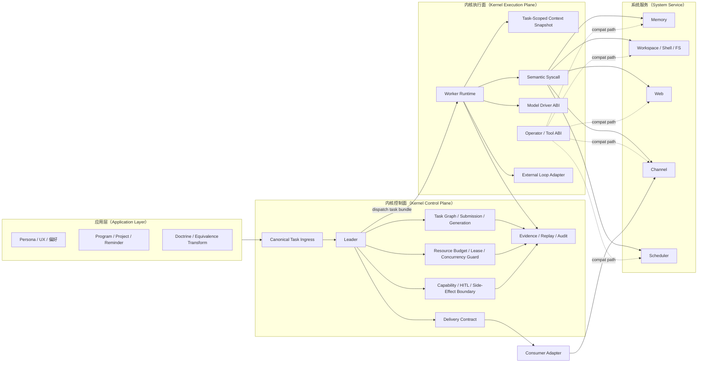
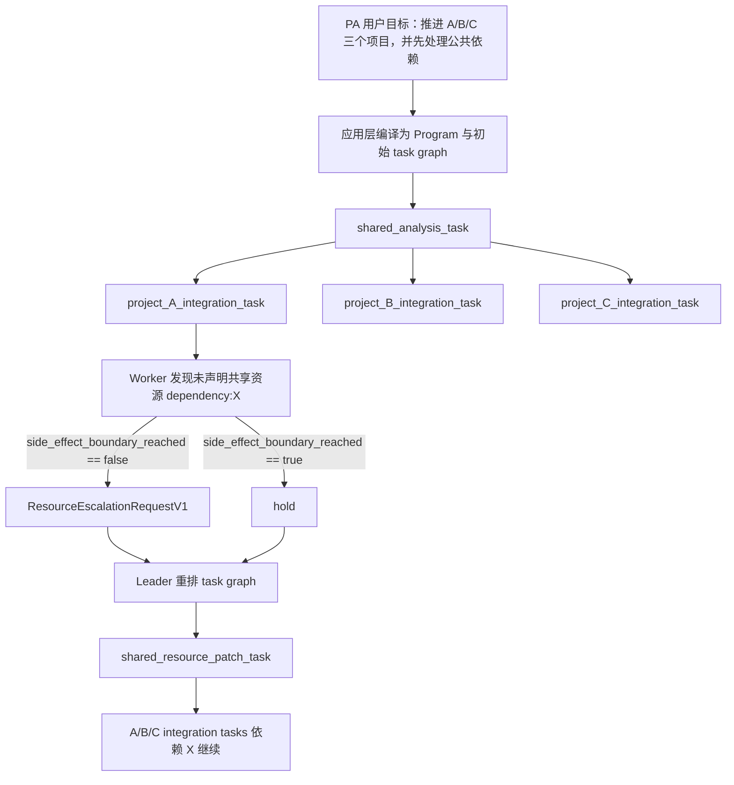

# ADR-0022：内核边界、资源模型与语义系统调用分层

- 状态（Status）：Accepted
- 日期（Date）：2026-03-14
- 说明（Note）：`Accepted` 表示设计边界与规范口径已冻结；剩余代码侧卡点按后续工作与实施 ticket 推进，不代表实现已全部落地。
- 相关规范（Related Specs）：
  - `docs/specs/MVP_045_QUERY_GATED_RUNTIME.md`
  - `docs/specs/MVP_050_TASK_ENVELOPE_DELIVERY_CONTRACT.md`
  - `docs/specs/MVP_055_KERNEL_EXECUTION_LANE_AND_TASK_AMENDMENT.md`
  - `docs/specs/MVP_057_KERNEL_CHARTER_AND_RESOURCE_MODEL.md`
  - `docs/specs/MVP_010_MEMORY.md`

## 背景（Context）

现有内核（Kernel）已经稳定具备以下基础能力：

- 任务服务（Task Service）与工作者任务（Worker Task）调度
- 工作者 ReAct 运行时（Worker ReAct Runtime）
- 能力（Capability）/策略（Policy）/证据（Evidence）/恢复（Replay）
- `hold / HITL` 这一类暂停语义

但近期问题说明仍存在一类结构性错位：

- 推理层直接面对底层 driver payload，而不是面对稳定语义动作
- 语义映射缺位时，业务语义会泄漏到内核输入 schema
- `hold / HITL` 已被当作内核暂停态使用，但并未在所有渠道中被视为强制交付态
- “切换视角、等价变换后继续求解”的能力没有稳定归位，容易与内核职责混淆

这些问题的共同根因不是单一 tool 不稳定，而是以下边界尚未冻结：

- 内核到底负责什么
- 服务层与 driver 层如何分层
- 模型默认应该面对什么抽象
- 资源预算应该如何被统一描述
- 内核顶层到底调度任务（Task）还是推理动作（Reasoning Action）

## 决策（Decision）

采纳以下不可逆方向作为新的内核宪章（Kernel Charter）：

1. 内核只负责稳定执行机制，不直接承载业务语义。
2. 内核的 canonical 责任冻结为：
   - 任务与 worker 调度
   - 资源管理与预算裁决
   - 能力、策略、人工介入（Human-in-the-loop, HITL）与副作用边界（Side-Effect Boundary）
   - 证据、耐久状态、恢复与可审计状态迁移
   - 终态与交付合同（Delivery Contract）
3. 内核之上正式分出系统服务（System Service）层，承载 `memory / web / channel / scheduler` 等稳定服务。
4. 推理层默认不得（MUST NOT）直接面向 raw driver payload；应首先面向语义系统调用（Semantic Syscall）。
5. driver/operator 只作为服务实现与兼容桥存在，不再作为默认 reasoning surface。
6. 每个可执行 operator 必须（MUST）声明完整的操作器合同（Operator Contract），至少包括：
   - purity / side-effect class
   - idempotency class
   - retry class
   - preflight validator
   - degraded semantics
   - 资源成本向量（Resource Cost Vector）
7. 内核的统一资源模型冻结为六类资源：
   - `compute`
   - `time`
   - `context`
   - `io`
   - `side_effect`
   - `delivery`
8. 内核的 canonical 调度单位必须（MUST）是任务（Task），而不是推理动作（Reasoning Action）。
9. 推理动作只可以（MAY）作为 task 内部的局部控制流、evidence event 或 worker-local 子循环存在；默认不得（MUST NOT）成为顶层 durable scheduler primitive。
10. 外部 agent loop、shell loop 或 provider-native tool loop 只可以（MAY）作为执行通道（Execution Lane）/executor strategy 插入；不得（MUST NOT）反向定义内核的调度单位。
11. 领导者（Leader）正式定义为内核控制面（control plane）角色，而不是外部 loop、provider 或普通 worker：
   - 独占 task graph 变更权
   - 独占共享资源 lease 分配权
   - 独占 `generation / supersede / hold / resume / final delivery` 裁决权
12. task 的执行输入必须（MUST）通过任务级上下文快照（Task-Scoped Context Snapshot）提供；该快照是“最小充分上下文包”，而不是系统全部已知上下文。
13. 当 task 信息不足时，系统必须（MUST）区分四类处理路径：
   - 可自动补齐：进入 context enrich
   - 可带显式假设继续：保留 assumption evidence 后执行
   - 不可安全补齐且需要用户补充：进入 `need_context`
   - 发现新的共享写资源、scope 扩张或 task graph 重排需求：升级给 Leader
14. 应用层（Application Layer）必须（MUST）负责 persona、产品语义、领域 doctrine、用户可见澄清策略与高层对象模型；内核不得（MUST NOT）直接承担这些职责。
15. `hold` 与 `HITL` 正式定义为内核中断态（kernel interrupt state），而不是普通失败态；所有 `hold` 终态都必须能被消费适配器（Consumer Adapter）交付。
16. 等价变换公理（Equivalence Transformation Axiom）明确归属 doctrine 层，而不是内核 primitive：
   - 当目标无法直接求解时，系统可以把目标变换为验收合同等价的问题再求解
   - 变换不得改变 acceptance contract
   - 变换不得引入新的 side-effect class
   - 变换必须留下可审计证据

## 参考架构图（Reference Architecture）

## 备选方案（Alternatives）

### 方案 A：继续把 raw operator surface 当作模型默认执行面

未采纳。原因：

- 语义映射会持续泄漏到底层 schema
- driver 兼容字段会污染推理面
- 相同业务目标在不同 driver 上难以保持稳定行为

### 方案 B：把业务语义直接收进内核 primitive

未采纳。原因：

- 内核会快速膨胀为业务规则容器
- 不同 app/domain 的语义变化会破坏内核稳定性
- 不利于 service/adapter 的演进与替换

### 方案 C：只靠 prompt 教学解决语义错配，不新增分层

未采纳。原因：

- prompt 只能缓解，不能替代 contract
- 无法给资源预算、恢复与副作用边界提供稳定语义
- 一旦模型输出漂移，仍会直接撞底层 ABI

### 方案 D：把推理动作（Reasoning Action）作为内核顶层调度单位

未采纳。原因：

- 推理动作高度依赖具体 provider、loop 模式与 prompt 结构，难以形成稳定 ABI
- durable recovery 会被迫绑定到 provider-native tool call / reasoning trace 语义
- 任务修订（Task Amendment）、side-effect boundary 与用户可见交付更难解释
- 不同外部 loop 很难在 action 粒度上保持可替换性

## 取舍（Tradeoffs）

收益：

- 内核职责更小、更稳定、更接近现代操作系统（Operating System, OS）中的资源管理与细节屏蔽角色
- 业务语义与 driver 兼容桥被隔离到更合适的层
- `hold / HITL`、side effect 与 delivery 语义可以统一到同一套资源与终态模型
- 可插拔 tool 从“暴露给模型的一组函数”收敛为“服务下的 driver 实现”
- 以 task 为调度单位后，外部 loop 可以被视为可替换执行策略，而不是新的 kernel
- task-scoped context snapshot 让执行面只看到最小充分上下文，而不是不受约束的全量历史

关于 `task` 与 `reasoning action` 的取舍：

- 采用 `task` 作为顶层调度单位的收益：
  - durable 恢复边界清晰
  - HITL、supersede、delivery contract 都能围绕同一业务目标解释
  - provider 与 loop 更容易替换
- 采用 `task` 的代价：
  - 无法默认在单个 reasoning action 粒度恢复
  - 内核看到的是较粗粒度执行单元，需要额外 evidence 才能解释 task 内部过程
- 若采用 `reasoning action` 作为顶层调度单位，收益是：
  - 细粒度 replay / debug
  - 对局部 tool-by-tool 轨迹更直观
- 但其代价更大：
  - provider/loop 耦合显著上升
  - action 语义漂移会直接破坏 kernel ABI
  - 很难定义统一的暂停、恢复与 side-effect boundary
  - 外部 loop 难以互换

代价：

- reasoning surface 需要从 raw operator 逐步迁移到 semantic syscall
- service、semantic adapter 与 driver 之间需要新增映射证据与调试面
- 现有若干 compat path 将在过渡期并存，文档与测试成本上升
- 应用层必须显式承担 persona、产品语义与澄清策略，而不能再把这些职责含混地塞回内核

## 后果（Consequences）

- `builtin://memory.write`、`builtin://web.search` 一类 raw operator 将保留，但其长期定位变为 driver/compat surface，而非默认语义 surface。
- 系统需要为“语义动作 -> 服务调用 -> driver 调用”建立稳定的映射证据。
- 预算模型不再只围绕 `tool_calls_max` 一类平面计数器；这些旧字段将被 ResourceBudgetV1 逐步取代，而不是立即移除。
- `hold` 的渠道交付不再是 app 特例，而应成为内核交付合同的一部分。
- OpenAI shell、provider-native tool loop、第三方 agent loop 等外部实现，未来若接入，只能作为 lane/executor strategy，而不是顶层调度器替代物。
- task 执行时看到的将是 task-scoped context snapshot；若发现共享写资源或关键缺口，必须经由 Leader 重排，而不是由 worker 直接扩大写范围。

## 任务上下文与信息不足（Task Context & Information Sufficiency）

`TaskSpecV1` 不要求（MUST NOT）携带完成任务所需的全部原始上下文；它只需要稳定表达：

- 目标与验收合同
- 资源与副作用边界
- 当前已知缺口（missing inputs）
- 上下文补齐策略（context strategy）

真正进入执行面的，是围绕单个 `submission_id + generation` 冻结出的任务级上下文快照（Task-Scoped Context Snapshot）。

- 该快照不是全量对话 transcript、全量代码库或系统全部已知 memory。
- 该快照必须（MUST）是“最小充分上下文包”，只包含当前 task 为达成 acceptance contract 所需且已获批准的上下文段。
- 该快照中的每个 segment 都应能够回溯 provenance，便于 replay、audit 与 stale result 判定。

当信息不足时，系统应按以下顺序处理：

- 若缺口可通过 memory recall、evidence 读取、file ref 展开等方式自动补齐，则进入 context enrich
- 若缺口不影响副作用边界且允许显式假设继续，则留下 assumption evidence 后执行
- 若缺口涉及用户确认、共享写资源或 scope 扩张，则必须升级给 Leader，而不是由 worker 自行扩大可见上下文或写范围

## 应用层边界（Application Layer Boundary）

应用层（Application Layer）负责：

- persona、沟通风格与用户可见文案
- 领域对象模型，例如项目（Project）、工作计划（Program / Workstream）、提醒（Reminder）、联系人（Contact）
- doctrine 选择，例如个人助理是“提醒优先”还是“项目推进优先”
- 缺少信息时的澄清策略与默认假设策略
- 高层语义到 task/program 的编译规则

应用层不得（MUST NOT）负责：

- task graph durable 调度
- 共享资源 lease
- generation guard 与 supersede 执行
- `hold / HITL` 的核心状态迁移
- replay / audit / evidence persistence

## 参考场景（Reference Scenario）

以个人助理（Personal Assistant, PA）场景为例：

- 用户说：“把 A/B/C 三个项目都推进一下，先处理公共依赖问题。”
- 应用层可以（MAY）把该目标编译成一个工作计划（Program / Workstream），但 Program 不是内核 primitive。
- 内核最终看到的仍然是 task graph，例如：
  - `shared_analysis_task`
  - `shared_resource_patch_task`
  - `project_A_integration_task`
  - `project_B_integration_task`
  - `project_C_integration_task`
  - `aggregate_delivery_task`

每个 task 执行时只拿到对应的任务级上下文快照（Task-Scoped Context Snapshot），而不是 A/B/C 三个项目的全量历史。

若 worker 在执行 `project_A_integration_task` 期间才发现还需要修改未声明的共享资源 `dependency:X`：

- worker 可以（MAY）提交 `ResourceEscalationRequestV1`
- worker 不得（MUST NOT）直接修改 `dependency:X`
- 若尚未越过 side-effect boundary，Leader 应该（SHOULD）直接重排 task graph
- 若已经越过 side-effect boundary，Leader 必须（MUST）把当前 task 转为 `hold` 或等价受控状态，再决定是否创建新的 shared resource task

该场景说明：

- Program 属于应用层语义对象
- Task 属于内核调度对象
- Task-Scoped Context Snapshot 属于内核批准的最小执行资料包
- Leader 属于内核控制面角色
- External loop 只能作为 executor strategy，不能直接改写 shared resource 调度语义

## 风险与缓解（Risks & Mitigations）

- 风险：semantic syscall 设计过粗，导致服务层再次变成“另一个松散 tool 列表”。
  - 缓解：要求 syscall 以稳定用户意图或服务语义命名，而不是按 driver 参数命名。
- 风险：资源模型过细，导致实现成本过高、调度难以解释。
  - 缓解：首版只冻结六类资源，不要求一次性精细到 provider-specific cost。
- 风险：compat driver surface 长期不收敛，最终继续成为默认执行面。
  - 缓解：规范要求 reasoning surface 优先 semantic syscall；raw driver 仅作为 compat 或专家模式暴露。
- 风险：等价变换被误用为“换个说法继续猜”。
  - 缓解：把等价变换明确限制在 doctrine 层，并要求 acceptance contract 不变与 verifier 回审。
- 风险：Leader 在 multi-workspace 或 multi-agent 场景下可能形成单点瓶颈或活性故障。
  - 缓解：后续规范需要补充 Leader liveness timeout 与超时后的受控 `hold` 语义。
- 风险：worker 频繁触发 shared resource escalation，退化为“每一步都经 Leader 批准”。
  - 缓解：后续规范需要冻结 `max_escalation_count` 默认值，并在超过上限后进入 `hold` 或 `need_context`。

## 可观测与验收（Metrics & Acceptance）

必须可观测：

- task/worker 的资源预算与消耗快照
- task 与 reasoning action 的映射证据
- semantic syscall 到 operator 的映射证据
- operator contract 中的 purity / idempotency / resource cost
- `hold` 终态到用户可见 delivery 的闭环
- 等价变换的输入目标、变换理由、输出目标与验收合同引用

验收标准：

- 新增 architecture docs 后，评审者能够明确回答：
  - 哪些能力属于 Kernel，哪些不属于
  - 为什么顶层调度单位是 task 而不是 reasoning action
  - reasoning surface 为什么默认不应直接暴露 raw driver payload
  - `hold/HITL` 为什么属于 kernel interrupt，而不是 app-layer failure
  - 等价变换为什么属于 doctrine 层，而不是 kernel primitive

建议验收命令：

- `PYTHONPATH=src:tests python3 -m unittest tests.test_thread045_query_gated_runtime -v`
- `PYTHONPATH=src:tests python3 -m unittest tests.test_thread044_pa_polling -v`
- `PYTHONPATH=src:tests python3 -m unittest tests.test_spike_memapi1_builtin_memory -v`

## 后续工作（Follow-ups）

- 把 `MVP_057` 收敛成 Kernel Charter、Resource Budget、Operator Contract 与 Semantic Syscall 的 normative spec。
- 为 memory、web、channel 三个系统服务定义首批 semantic syscall。
- 将 raw operator surface 标注为 `canonical | compat | internal` 三种可见性级别。
- 为等价变换补一份单独 doctrine 规范，定义适用条件、风险分级与 verifier 回审要求。
- 为 `ResourceEscalationRequestV1` 与 `AssumptionEvidenceV1` 冻结最小 schema 与错误语义。
- 形式化 `need_context` 触发条件、Leader caller-role 约束与 `E_REASONING_ACTION_SCHEDULING_FORBIDDEN` 的首个落地入口。
- 审计并迁移应用层语义相关模块的归属，至少包括：
  - `src/agentos_next/kernel/soul_profile.py`
  - `src/agentos_next/kernel/agent_profile.py`
  - `src/agentos_next/kernel/prompt_compiler.py` 中与 persona/应用语义强耦合的部分
- 为 task-scoped context snapshot 的 `token_estimate` 提供统一估算基础设施，并明确 `content_hash` 的实现与归一化策略。
- 为 `token_budget.max_total_tokens -> compute_units` 提供单一 legacy 映射函数，避免 admission 入口各自实现近似换算。

评审意见（Review Comments）
评审者：Antigravity (External AI Reviewer) 日期：2026-03-14

一、与现有代码的对齐分析
1.1 已对齐
决策点 代码现状  判定
Task 作为顶层调度单位 

KernelTaskService
 已完整围绕 TaskSpec → TaskRecord → TaskRunResult 做 admission / 状态迁移 / supersede / hold  ✅ 完全对齐
EffectClass 四级 purity 

execution_lane.py
 已定义 read_only / workspace_write / external_effect / user_visible_delivery  ✅ 完全对齐
hold 不等于失败态 

task_service.py
 的 

_finish_attempt
 已将 hold 映射为 hold 而非 failed；supersede 逻辑对 hold 态做了保护  ✅ 基本对齐
Side-effect boundary  

mark_side_effect_boundary
 已实现，越界后 

supersede_submission
 禁止静默 supersede ✅ 完全对齐
等价变换归 doctrine 层  

research_doctrine.py
 的 selected_doctrine_pack 机制已将推理策略放在 doctrine 层而非 kernel primitive  ✅ 方向对齐
1.2 尚有差距
决策点 代码缺口  严重程度
OperatorContractV1  

operator_catalog.py
 的 13 个 operator 仅声明 operator_ref / summary / match_terms / required_capabilities / policy_disposition，缺少 purity / idempotency_class / retry_class / preflight_required / degraded_behavior / resource_cost_vector / visibility 全部字段  🔴 高
ResourceBudgetV1 六类资源 

TaskSpec
 / 

TaskRecord
 仍使用 tool_budget / token_budget / stop_policy / time_budget_ms 平面字段，未收敛为 compute_units / time_budget_ms / context_units / io_calls_max / side_effect_calls_max / delivery_ops_max 🔴 高
SemanticSyscallV1 层 代码中不存在 semantic syscall 注册表或解析层；推理面仍直接面向 builtin:// operator ref  🔴 高
ResourceCostVectorV1  无任何 operator 声明 cost vector；

infer_effect_class
 仅按前缀推断 purity  🟡 中
hold 交付保证 hold 进入后未在代码层面强制产出 delivery artifact；spec 要求 Consumer Adapter 不得发空 delivery 🟡 中
Operator visibility 三级标记  

operator_catalog
 中无 canonical / compat / internal 标记  🟡 中
二、架构意见
2.1 context_units 语义需要落地定义
ADR 与 spec 提出 context_units = 8 默认值，但未定义 1 个 context unit 到底等价什么。建议二选一：

方案 A：1 context_unit = 1 次 context retrieval / evidence injection（与 io_calls_max 不同维度），那么 context_units 度量的是"推理面被动注入的上下文片段数"。
方案 B：1 context_unit ≈ N tokens 的上下文窗口占用，那么它与 

token_budget
 有明确映射关系。
建议：采用方案 A，并在 spec 中补充："context_units 计数的是 distinct context segment injections（含 memory recall、evidence injection、file ref expansion），而非 token 数。"

2.2 ResourceBudgetV1 与现有 tool_budget / token_budget / stop_policy 的迁移关系
当前 

TaskSpec
 中的三段式预算与 ResourceBudgetV1 有重叠又不完全等价：

现有字段  对应 ResourceBudgetV1 映射方式
tool_budget.max_calls io_calls_max  近似，但现有 max_calls 包含 read_only + write；新模型 io_calls_max 是否只算 IO 类？
token_budget.max_total_tokens compute_units 不同量纲：token 计数 vs. 抽象 compute unit
stop_policy.deadline_ms time_budget_ms  直接映射
无 side_effect_calls_max 新增
无 delivery_ops_max  新增
无 context_units 新增
建议：在 spec 中增加一节 Migration Mapping，明确过渡期内 

TaskSpec
 既支持旧字段也支持 ResourceBudgetV1；runtime 在 admission 时做归一化。否则现有全部 test 和 caller 都会一次性断裂。

2.3 Semantic Syscall 的注册与解析链需要最小原型
当前不存在 semantic syscall 层。建议首版不要一次性覆盖所有 operator，而是：

先为 memory service 定义 3 个 semantic syscall：mem.recall / mem.persist / mem.forget。
在 

operator_catalog.py
 旁新增 syscall_registry.py，维护 syscall_ref → operator_ref[] 映射。
推理面优先使用 syscall_ref；planner 解析时生成 evidence。
后续再扩展到 web、channel、scheduler。
这样可以验证分层思路，同时不阻塞现有 operator 的运行。

2.4 OperatorContractV1 的落地路径

operator_catalog.py
 中 13 个 operator 全部缺少合同字段。建议：

python
# 示例：在 _catalog_entries 中补齐
{
    "operator_ref": "builtin://memory.search",
    "summary": "Search layered memory and evidence records.",
    "match_terms": [...],
    "required_capabilities": ["memory_search"],
    "policy_disposition": "allow",
    # --- 新增 OperatorContractV1 字段 ---
    "purity": "read_only",
    "idempotency_class": "idempotent",
    "retry_class": "safe",
    "preflight_required": False,
    "degraded_behavior": "surface_to_runtime",
    "visibility": "canonical",
    "resource_cost_vector": {
        "compute_cost": 1,
        "time_cost": 0,
        "context_cost": 1,
        "io_cost": 1,
        "side_effect_cost": 0,
        "delivery_cost": 0,
    },
}
建议：第一步只要求所有 operator 声明 purity 和 visibility（这两个已经有推断逻辑可参考），其余字段允许走 compatibility default。这避免一次性改动过大。

2.5 hold 的交付保证需要代码级 gate
当前 

_finish_attempt
 把 hold 正确标记为 hold 状态，但并未校验是否产出了 delivery artifact。建议在 

_finish_attempt
 的 hold 分支中加一条断言或 warning：

python
if task_status == "hold" and not run_result.evidence_refs:
    # E_HOLD_DELIVERY_MISSING
    ...
否则 spec 的 "Consumer Adapter 不得发空 delivery" 约束只是文字，无代码保障。

2.6 E_REASONING_ACTION_SCHEDULING_FORBIDDEN 的触发点
ADR 和 spec 都声明了这个错误码，但没有说明在哪段代码/哪个入口应该检查并抛出。建议明确：

触发位置：KernelTaskService.submit_task 或未来的 ExternalLoopAdapter.register
触发条件：外部 loop 试图绕过 Task 层直接注册 action-level durable primitive
首版可不实现，但 spec 应注明 "首版本错误码保留，实现延后到外部 loop 接入时"
三、措辞与规范性修订建议
第 6 条 retry class：spec 中 retry_class 枚举缺失。建议补充取值：safe / idempotent_retry / no_auto_retry。
第 7 条 资源类：建议在 spec 和 ADR 中统一 

io
 的精确范围——是只计 I/O bound 外部调用，还是也包含 workspace file read/write？当前 io_calls_max 歧义较大。
第 12 条 等价变换："变换不得改变 acceptance contract" 建议补一句"且不得引入新的 side-effect class"，防止变换路径绕过副作用边界。
后果 第 3 点：tool_calls_max 一类平面计数器——建议注明它将被 ResourceBudgetV1 逐步取代，而非立即移除。
四、风险补充
风险 5（新增）：ResourceBudgetV1 的 6 类资源若在 admission 时全部校验，可能导致现有 task 大量被拒（因未声明 cost vector 的 operator 无法通过预算检查）。

缓解：首版 budget enforcement 只对 side_effect_calls_max 和 delivery_ops_max 做硬检查；其余 4 类为 advisory / log-only。
风险 6（新增）：semantic syscall 层与 raw operator 双路径长期并存，可能导致推理面看到"名字不同但行为相同"的两套 tool，增加 token 浪费和决策混乱。

缓解：当 semantic syscall 存在时，对应 raw operator 默认不出现在推理面（reasoning surface hide by default），除非显式启用 visibility = compat 且 planner 标记 expert mode。
五、总体判定
维度  判定
方向可行性 ✅ 方向正确，Task-centric + 分层 + 资源向量化是正确演进路线
与现有代码的一致性 🟡 方向一致但实现差距大；至少 3 个 spec-mandated 数据结构（OperatorContractV1 / ResourceBudgetV1 / SemanticSyscallV1）在代码中不存在
可落地性  🟡 需要明确分阶段落地计划；建议拆为 Phase 1（purity + visibility 标记 + hold delivery gate）→ Phase 2（ResourceBudgetV1 + OperatorContractV1 完整）→ Phase 3（SemanticSyscallV1 首批 + reasoning surface 切换）
文档完整性 ✅ ADR 结构完整，备选方案充分，取舍清晰
规范性 🟡 少数字段枚举未在 spec 闭合（retry_class）；context_units 语义未定义
建议状态：保持 Proposed，待以上 Phase 1 的代码变更与 spec 修订完成后，可迁入 Accepted。

增量评审意见（Review Comments — Round 2）
评审者：Antigravity (External AI Reviewer) 日期：2026-03-14

一、新增决策点评审
1.1 Leader 控制面角色（决策 11）— ✅ 支持
判定：关键且必要的决策。

现有代码中 

KernelTaskService
 的 

supersede_submission
、

mark_side_effect_boundary
、

_finish_attempt
 等方法实质上已在执行 Leader 裁决逻辑——但"谁有权调用这些方法"在代码层面尚无 caller identity 校验。
建议在 spec 中补充：Leader 的三个独占权是否需要在代码层面做 caller-role assertion？例如在 

supersede_submission
 入口做 assert caller_role == "leader" 类检查。首版可只靠调用约定，但随着 multi-agent delegation 出现，需要硬 gate。
1.2 Task-Scoped Context Snapshot（决策 12–13）— ✅ 支持，需补充
判定：填补了关键空白。 Task 之前只有 input_refs 指向上下文，缺少"最小充分上下文包"的正式概念。

需补充项：

Snapshot 的 schema 原型：当前 ADR 没有给出 TaskContextSnapshotV1 的最小字段列表。建议至少冻结：

context_segments: list[ContextSegment]（每段含 source_ref / kind / content_hash / token_estimate）
missing_inputs: list[MissingInput]（每条含 input_key / resolution_strategy）
frozen_at_generation: int（与 generation guard 联动）
三类处理路径与代码的对应：当前 

worker_react_runtime.py
 中，worker 遇到信息不足时的行为是什么？是否有 need_context 状态？从 

task_service.py
 看 

_finish_attempt
 已支持 need_context 状态映射，但触发条件未在 worker 侧形式化。

"可带假设继续"的 evidence 格式：建议在 spec 中定义 assumption_evidence 的 schema（至少含 assumption_text / confidence / fallback_strategy），否则"留下 assumption evidence"只是口头约束。

1.3 应用层边界（决策 14）— ✅ 支持
判定：极为重要的边界冻结。 此前 persona / 澄清策略容易被混入内核 prompt compiler，造成内核臃肿。

与现有代码的对照：

prompt_compiler.py
 和 

soul_profile.py
 属于哪一层？按新决策，persona 归应用层。如果 

soul_profile.py
 仍位于 kernel/ 目录下，需要迁移到 apps/ 或 

pa/
 下，否则目录结构与决策矛盾。

agent_profile.py
 同理——建议后续工作中注明哪些现有 kernel/ 模块需要迁出。
1.4 参考架构图 — ✅ 清晰
判定：mermaid 图有效传达了四层分层。 几个小建议：

控制面（B）中 Leader → Worker 的箭头经过了 subgraph 边界；建议标注这条边为"dispatch task bundle"。
ToolABI → System Service 的连线应标注为 compat path，与 Syscall → System Service 的 canonical path 做视觉区分。
Delivery → Channel 需要标注经过 Consumer Adapter，避免读者认为内核直接写渠道。
1.5 参考场景 — ✅ 极有价值
判定：PA 多项目推进场景是最好的试金石。 补充意见：

resource_escalation_request 目前不是代码中的数据结构。建议在后续工作中标注：需在 

task_service.py
 或 

worker_react_runtime.py
 中定义 ResourceEscalationRequest 的 schema 及 Leader 的处理协议。
场景流程图（第二个 mermaid 图）在 "Worker 发现未声明共享资源" 节点后分叉为两条路径（hold 和 resource_escalation），建议标注分叉条件：side_effect_boundary_reached == true → hold，side_effect_boundary_reached == false → Leader 直接重排。
二、上轮意见采纳情况
上轮意见  采纳状态  备注
等价变换补"不得引入新的 side-effect class" ✅ 已采纳 决策 16.c
tool_calls_max 被逐步取代而非立即移除  ✅ 已采纳 后果第 3 点
context_units 语义定义  ❌ 未采纳 仍需在 spec 中明确
retry_class 枚举闭合  ❌ 未采纳 仍需在 spec 中补充

io
 精确范围 ❌ 未采纳 仍需在 spec 中明确
Migration Mapping 节 ❌ 未采纳 仍需在 spec 中新增
hold 代码级 gate ❌ 未采纳（文档层面够了，代码待落地） —
三、新增风险
风险 7（新增）：Leader 独占权在 multi-workspace 或 multi-agent 场景下，可能形成单点瓶颈。如果 Leader 自身 hang 或漂移，所有 worker task 都无法推进。

缓解：定义 Leader 的 liveness timeout；超过 timeout 无响应时，kernel 应自动把所有 running tasks 转为 hold 并记录 E_LEADER_TIMEOUT evidence。
风险 8（新增）：Task-Scoped Context Snapshot 的"最小充分"判定依赖 query compile 质量。如果 compile 漏掉关键上下文，worker 会频繁触发 context escalation，导致 Leader 被打断率过高。

缓解：首版允许 snapshot 保守偏大（over-provision），但对 snapshot 的 token_estimate 总量设上限；后续再根据 escalation 频率数据优化 compile 精度。
风险 9（新增）：resource_escalation_request 如果没有速率控制，worker 可能在每一步都尝试 escalate，退化为"每个 action 都经 Leader 批准"的模式，丧失 worker 自主性。

缓解：定义每个 task 的 max_escalation_count（建议默认 2），超限后自动转 hold 而非无限 escalate。
四、更新后总体判定
维度  上轮  本轮  变化
方向可行性 ✅ ✅ 无变化
架构完整性 — ✅ 新增的 Leader 角色、context snapshot、应用层边界和参考场景让架构从"五条规则"升级为"可执行框架"
与现有代码的一致性 🟡 🟡 三个 V1 数据结构仍未落地；新增的 Leader 独占权 / context snapshot / resource escalation 也暂无代码对应
可落地性  🟡 🟡 需要在分阶段计划中新增 Phase 0.5：

soul_profile.py
 迁到应用层 + Leader caller-role 约定 + need_context 触发条件形式化
文档完整性 ✅ ✅✅  参考架构 + 参考场景显著提升了可读性
建议状态：仍建议保持 Proposed。但本轮补充后，ADR 的决策覆盖面和可解释性都有实质性提升，距离 Accepted 更近了一步。剩余卡点主要是：

TaskContextSnapshotV1 的最小 schema
retry_class / context_units / 

io
 的枚举与语义闭合
ResourceEscalationRequest 的协议定义
现有 kernel/ 目录中 persona 相关模块的归属标注
这些在 MVP_057 spec 中补齐即可。

评审意见（Review Comments — Round 3）
评审者：Antigravity (External AI Reviewer) 日期：2026-03-14

一、上轮意见采纳情况
上轮意见  采纳状态  落地位置
context_units 语义定义  ✅ 已采纳 spec ResourceBudgetV1 新增"语义（MUST）"小节：distinct context segment injections
retry_class 枚举闭合  ✅ 已采纳 spec OperatorContractV1：safe / idempotent_retry / no_auto_retry

io
 精确范围 ✅ 已采纳 spec 边界条件："io_calls_max 默认同时覆盖 workspace file read/write 与外部 I/O 类 operator"
Migration Mapping 节 ✅ 已采纳 spec 新增 Migration Mapping 节，含映射规则与过渡期 enforcement
TaskContextSnapshotV1 schema  ✅ 已采纳 spec 新增完整结构：snapshot_id / task_id / frozen_at_generation / selected_context / open_gaps / provenance
AssumptionEvidenceV1 schema ✅ 已采纳 spec 新增：assumption_text / confidence / fallback_strategy / snapshot_id
ResourceEscalationRequestV1 协议  ✅ 已采纳 spec 新增完整结构含 max_escalation_count 联动与 side-effect boundary 判定
Leader caller-role assertion  ✅ 已采纳 spec LeaderBoundaryV1：首版 internal-only API，后升级为显式 assertion
E_REASONING_ACTION_SCHEDULING_FORBIDDEN 触发时机  ✅ 已采纳 spec 边界条件：首版保留，ExternalLoopAdapter 出现时必须落地
架构图标注 dispatch task bundle  ✅ 已采纳 ADR mermaid `Leader -->
架构图 compat path 虚线  ✅ 已采纳 ADR mermaid ToolABI -. "compat path" .->
Delivery → Consumer Adapter → Channel ✅ 已采纳 ADR 新增 Consumer 节点
场景图分叉条件标注 ✅ 已采纳 side_effect_boundary_reached == true/false 条件标注
模块迁移标注  ✅ 已采纳 ADR 后续工作新增对 

soul_profile.py
、

agent_profile.py
、

prompt_compiler.py
 的迁移审计
Leader liveness timeout 风险  ✅ 已采纳 ADR 风险新增 Leader 单点 + liveness timeout 缓解
escalation 速率控制 ✅ 已采纳 ADR 风险 + spec max_escalation_count 联动
hold 代码级 gate — 代码层面待落地，文档已充分
采纳率：17/18 = 94%。 文档侧已几乎全部闭合。

二、新增内容评审
2.1 LeaderBoundaryV1（spec 第 84–100 行）— ✅ 精确
三级渐进策略（首版 internal-only → 后续 caller-role assertion）是正确的工程节奏。

一个小改进建议：当前 E_KERNEL_CHARTER_VIOLATION 同时覆盖"非 Leader 试图修改 task graph"和其他违反内核宪章的行为。如果后续需要做审计统计，建议考虑是否拆出一个专门的 E_LEADER_PRIVILEGE_VIOLATION。不急，可以留到实际遇到时再决定。

2.2 TaskSpecV1 扩展（spec 第 102–139 行）— ✅ 完整
新增的 missing_inputs / context_strategy / max_escalation_count / application_context_ref 四个字段精确对应了 ADR 中 task context 和 application boundary 的决策。特别好的设计：

application_context_ref 作为 opaque ref，内核不解释——这正是"内核不承载业务语义"的代码级体现。
context_strategy 三个取值 (auto_enrich_then_clarify / clarify_before_execution / assumption_allowed) 覆盖了三条路径。
一个发现：spec 中 TaskSpecV1 有 4 个 context_strategy 处理路径（auto_enrich / assumption_continue / need_context / leader_escalation），但 context_strategy 字段只有 3 个取值。leader_escalation 并没有作为 context_strategy 的取值出现——这是正确的，因为 leader_escalation 是运行时判定的结果，不是提交时的策略选择。但建议在 spec 中加一句注释明确这个区分，避免读者混淆。

2.3 TaskContextSnapshotV1（spec 第 141–179 行）— ✅ 结构清晰
frozen_at_generation 与 generation guard 联动是关键设计——确保 snapshot 在 supersede 后能被正确判定为 stale。

需注意的点：

selected_context.context_segments 每段要求 token_estimate——这意味着 runtime 在 compile snapshot 时需要对每个 segment 做 token counting。现有 

context_compiler.py
 或 

prompt_compiler.py
 是否已有 token estimation 能力？如果没有，这是落地时需要补的基础设施。
content_hash 字段的引入很好，它让 replay 和 stale detection 有了确定性依据。但需要定义 hash 算法（建议 SHA-256 的前 16 hex）和是否对 content 做归一化再 hash。
2.4 AssumptionEvidenceV1（spec 第 181–201 行）— ✅ 简洁有效
confidence ∈ [0.0, 1.0] + fallback_strategy 三取值的设计足够用。

一个建议：confidence 的产生方目前未定义——是由 worker runtime 自行打分，还是由 model 输出？建议在注释中明确 confidence 是 runtime-assigned estimate，而非 calibrated probability，防止下游过度信赖该数值。

2.5 ResourceEscalationRequestV1（spec 第 203–229 行）— ✅ 完整
escalation_count 与 max_escalation_count 的联动、side_effect_boundary_reached 的分叉处理都已形式化。

需注意：requested_effect_class 的约束是"比当前已批准 effect class 更宽或不同"——这个比较关系需要 EffectClass 有一个明确的偏序（partial order）。当前 

execution_lane.py
 中的 4 级 EffectClass 隐含的偏序是 read_only < workspace_write < external_effect < user_visible_delivery。建议在 spec 中显式写出这个偏序，否则"更宽"的判定缺少形式化依据。

2.6 ExternalLoopAdapterContractV1（spec 第 348–366 行）— ✅ 适时的预留
scheduling_mode 首版只允许 task_scoped 是正确的约束。三个 supports_* 布尔标志位的默认值都是 false——这意味着默认接入的外部 loop 不满足任何 kernel 要求，确保安全。

2.7 Information Sufficiency 状态机（spec 第 421–450 行）— ✅ 关键补充
四条路径 (auto_enrich / assumption_continue / need_context / leader_escalation) + worker 行为约束 + Leader 分叉判定，覆盖完整。

建议：这段逻辑在代码中目前没有对应的形式化实现。落地时建议在 

worker_react_runtime.py
 中新增一个 resolve_information_gap(gap: MissingInput) -> InformationSufficiencyResult 函数，让四条路径有确定性入口。

2.8 Migration Mapping（spec 第 259–273 行）— ✅ 关键
过渡期 enforcement 分两档（side_effect_calls_max / delivery_ops_max 硬约束 vs. 其余 advisory）是务实的。

一个注意：token_budget.max_total_tokens -> resource_budget.compute_units 标注为"近似 seed"——这个映射关系需要在代码中有一个 legacy_token_budget_to_compute_units(max_total_tokens: int) -> int 转换函数。建议在后续工作中明确这个函数的实现策略（例如 compute_units = max_total_tokens // 1000 或类似简单映射）。

三、ADR 与 Spec 的一致性检查
检查项 ADR Spec  一致性
Leader 独占权  决策 11（3 条独占权） LeaderBoundaryV1（5 条独占权，更细） ✅ spec 是 ADR 的精细化
Task context snapshot 决策 12 TaskContextSnapshotV1 + Information Sufficiency ✅ 一致
信息不足三类路径  决策 13（3 类）  spec 定义为 4 类（新增 leader_escalation）  ⚠️ ADR 写"三类"但 spec 拆成了四类；建议 ADR 也更新为四类，保持对齐
应用层边界 决策 14 Application Boundary  ✅ 一致
等价变换 side-effect 约束 决策 16.c spec Equivalence Transformation Boundary  ✅ 一致
ResourceEscalationRequestV1 ADR 参考场景  spec 完整 schema  ✅ 一致
模块迁移  ADR 后续工作列出 3 个模块  spec 未涉及  ⚠️ 正常——代码迁移不属于 spec 范围
PA 参考场景 ADR 独立大节  spec 作为 Boundary Conditions 子节  ✅ 一致，详略适当
四、剩余卡点（从 Round 1 至今的未闭合项）
代码层面 OperatorContractV1 字段补齐——文档已完备，需要在 

operator_catalog.py
 落地。
代码层面 ResourceBudgetV1 替换 tool_budget / token_budget——spec 已定义迁移路径，需要在 

task_service.py
 和 

execution_lane.py
 落地。
syscall_registry.py 首版——spec 定义了 SemanticSyscallV1，但代码中仍无注册表。

_finish_attempt
 中 hold delivery gate——spec 定义了 E_HOLD_DELIVERY_MISSING，代码中需要落地。

worker_react_runtime.py
 中 resolve_information_gap 形式化——spec 定义了四条路径，代码需要对应入口。
EffectClass 偏序——需在 spec 显式写出。
content_hash hash 算法——需在 spec 或 implementation note 中定义。
ADR 决策 13 "三类" → 应更新为"四类"——与 spec 的四路径对齐。
五、总体判定
维度  Round 2 Round 3 变化
方向可行性 ✅ ✅ 无变化
架构完整性 ✅ ✅✅  spec 从 308 行 → 598 行，新增 7 个 V1 数据结构 + migration mapping + PA 场景
ADR ↔ Spec 一致性  — ✅ 仅决策 13 的"三类 vs 四类"需要对齐
规范闭合度 🟡 ✅ retry_class / context_units / 

io
 范围全部闭合
可落地性  🟡 🟡→🟢 migration mapping + 过渡期分档 enforcement 让落地路径从模糊变清晰；剩余工作集中在代码实现
文档完整性 ✅✅  ✅✅✅ 几乎无文档层面遗漏
建议状态：可以考虑迁入 Accepted。

ADR 和 spec 在文档层面已经高度闭合。剩余的 8 个卡点全部是代码实现层面的，不再是设计层面的决策空白。如果团队认可"文档闭合即可 Accept，代码落地走后续 ticket"的流程，现在就可以 Accept。如果要求"至少 Phase 1 代码落地才 Accept"，那建议先把 ADR 决策 13 从"三类"改为"四类"后保持 Proposed，然后集中精力做 Phase 1 代码。

评审意见（Review Comments — Round 4）
评审者：Antigravity (External AI Reviewer) 日期：2026-03-14

一、上轮意见采纳情况（基于代码库最新状态）
文档侧的 3 个遗留卡点已全部闭合：
1. **决策 13 的“三类”更新**：✅ 已采纳。ADR 文本已更新为“区分四类处理路径”，与 Spec 对齐。
2. **EffectClass 偏序**：✅ 已采纳。`MVP_057_KERNEL_CHARTER_AND_RESOURCE_MODEL.md` 中已显式补充偏序关系。
3. **content_hash 算法定义**：✅ 已采纳。Spec 中明确首版算法固定为 `sha256(normalized_content)` 的前 16 个十六进制字符。
4. **新增词汇收录**：✅ 经核实 `docs/glossary.md` 已补充“任务级上下文快照”、“语义系统调用”、“等价变换公理”等词汇，完全符合 AGENTS.md 写作规范。

代码侧的 5 个卡点（Phase 1 落地）仍待后续 Ticket 落实：
1. `operator_catalog.py` 中 `OperatorContractV1` 字段补齐。
2. `task_service.py` 和 `execution_lane.py` 中 `ResourceBudgetV1` 的迁移落地。
3. 首版 `syscall_registry.py` 的建立。
4. `task_service.py` (`_finish_attempt`) 中的 `hold` delivery gate (`E_HOLD_DELIVERY_MISSING`)。
5. `worker_react_runtime.py` 中 `resolve_information_gap` 的入口形式化。

二、总体判定及建议状态
维度 | 状态判定 | 备注
---|---|---
方向可行性 | ✅ | 无变化，Task-centric 路线稳固。
架构完整性 | ✅✅ | Spec 和 ADR 在概念切分上已达完备。
文档规范性 | ✅✅✅ | ADR 决策项、Glossary 术语对齐、Spec 格式全数符合仓库规范。
代码可落地性 | 🟢 | 文档侧已扫清所有歧义。Phase 1 代码实施已可直接依据 Spec 展开。

**核心结论与状态建议**：
鉴于 ADR 和 Spec 在文档、概念和Repo规范层面已经**彻底闭合**，当前文档已具备作为指导准则的最高完备度。
**建议将 ADR-0022 的状态（Status）正式从 `Proposed` 变更为 `Accepted`**，并将剩余的 5 个代码侧执行卡点拆分为对应的 Issue 推进落地。
