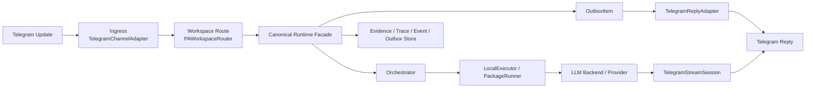

# PA 架构总览（Architecture Overview）

本文面向维护者，说明 Telegram Personal Assistant（PA）的主要组件、关键状态流与观察点。它不是规范，规范以 `docs/specs/` 为准。

## 1. 目标

PA 的运行链路需要同时满足四件事：

- 能稳定接收 Telegram 入站消息。
- 能把消息送入 canonical runtime，并在失败时生成稳定兜底回复。
- 在支持流式的 LLM 提供方（LLM Provider）上，提供可接受的 Telegram 流式体验。
- 对关键状态进行落盘，便于重放、审计与排障。

## 2. 主链路

## 3. 核心组件

### 3.1 入站层

- `src/agentos_next/apps/telegram_connector.py`
  - 负责将 Telegram payload 解析为内部更新对象。
- `src/agentos_next/apps/pa_polling_service.py`
  - 负责 `getUpdates` 轮询、offset 续跑、调度器自动 tick、出站发送。
- `src/agentos_next/apps/pa_webhook_server.py`
  - 负责 webhook 模式下的入站处理。
- `src/agentos_next/apps/pa_workspace_router.py`
  - 负责按 Telegram chat/user 映射到工作区。

### 3.2 执行层

- `src/agentos_next/apps/pa_assistant_runtime_dispatcher.py`
  - PA 的 submitter/consumer 收口层，负责事件校验、落盘、dedup、Outbox 与 Telegram reply 适配。
- `src/agentos_next/apps/query_gated_runtime.py`
  - 负责 Query Compile、Context Plane、Operator 解析与 runtime capability 投影。
- `src/agentos_next/apps/assistant_loop.py`
  - 负责 assistant loop、research doctrine、verification、runtime snapshot 与最终输出收口。
- `src/agentos_next/kernel/orchestrator.py`
  - 负责把请求交给具体执行器并处理超时等统一错误。
- `src/agentos_next/runtime/local_executor.py`
  - 本地执行入口，承接 skill/builtin 执行。
- `src/agentos_next/runtime/package_runner.py`
  - skill 执行桥，向下连接 LLM 执行或 builtin。

### 3.3 模型与流式层

- `src/agentos_next/llm/backend.py`
  - 统一 LLM backend，负责错误封装与 schema 校验。
- `src/agentos_next/llm/openai_codex_oauth.py`
  - Codex OAuth provider，支持普通返回与 SSE 流式返回。
- `src/agentos_next/apps/telegram_reply.py`
  - Telegram 出站与流式会话实现，含 typing 心跳、占位消息、增量编辑、最终收口。

### 3.4 持久化与观测层

- `data/pa/events/<workspace>/`
  - 原始入站事件落盘。
- `data/pa/outbox/<workspace>/`
  - 要发送给用户的最终/兜底回复落盘。
- `data/pa/polling_offsets/`
  - 轮询 offset 检查点（Offset Checkpoint）。
- `data/traces/`
  - 追踪（Trace）时间线。
- `data/evidence/`
  - 证据（Evidence）对象。

## 4. 关键状态对象

### 4.1 EventEnvelope

- 代表一次入站消息。
- 负责把 Telegram `message.text`、chat、sender、时间戳等字段带入执行链路。

### 4.2 OutboxItem

- 代表一次对用户可见的回复。
- 即使底层执行失败，也可以通过 OutboxItem 发送稳定兜底文案。
- 当流式已在 Telegram 侧发出时，会带 `reply_sent_live=true`，用于避免后续重复发送。

### 4.3 TelegramStreamSession

- 负责把 provider 的增量事件转成 Telegram `editMessageText`。
- 关键职责：
  - 先发占位消息。
  - 维持 typing 心跳。
  - 本地缓冲多个增量 chunk 后再刷新，避免逐字抖动。
  - 一旦完成，用最终文本收口同一条消息。

### 4.4 HypothesisRecord

- 记录“假设 -> 验证 -> 修正”闭环。
- 用于避免下一轮重复走同一条失败路径。

## 5. 两条容易混淆的链路

### 5.1 Outbox 直发链

适用于：

- 非流式回复。
- 流式失败后的最终回退。
- 执行失败时的稳定兜底回复。

链路：

`Canonical Runtime Facade -> OutboxItem -> TelegramReplyAdapter.handle_outbox_item()`

### 5.2 流式直播链

适用于：

- Telegram 渠道。
- backend/provider 支持增量输出。

链路：

`LLM provider SSE -> llm_stream_callback -> TelegramStreamSession -> Telegram editMessageText`

这条链路的关键实现要求是：Telegram 出站不能阻塞 provider SSE 读取，否则会导致“越流越卡”甚至超时。

## 6. 当前主要稳定性设计

### 6.1 offset 续跑

- 轮询服务会按 bot token 维度持久化 `next_offset`。
- 重启后如未显式传 `--offset`，会从检查点继续，而不是重新消费历史消息。

### 6.2 dedup + 可见兜底

- 同一 event 命中 dedup 时，不应重复发用户回复。
- 但当执行失败且已生成 OutboxItem 时，仍应把兜底消息发出去，不能只在落盘中存在。

### 6.3 provider 瞬态错误自愈

- 对“首个 delta 之前”的 TLS EOF、远端提前断开等瞬态网络错误（Transient Network Error），provider 层允许一次短重试。
- 若已向 Telegram 侧输出过任何 delta，则不再重试，避免重复/错序文本。

### 6.4 流式平滑

- provider 的增量读取与 Telegram 文本编辑已经解耦。
- 本地先缓冲多个 chunk，再由后台发送线程异步刷新 Telegram。

## 7. 首选观测入口

排障时建议按这个顺序看：

1. 终端日志
   - 看是否收到 update、是否保存 offset、是否发送 reply、是否出现 provider/network 细节。
2. `data/pa/outbox/<workspace>/<event_id>.json`
   - 判断 canonical runtime 是否已经生成用户可见回复。
3. `data/traces/tr_pa_<event_id>.jsonl`
   - 判断卡在入站、执行、provider 还是出站。
4. `data/pa/events/<workspace>/<event_id>.json`
   - 确认原始入站 payload。
5. `data/pa/polling_offsets/*.json`
   - 确认是否从错误 offset 重放了旧消息。

## 8. 关联规范

- `docs/specs/PA_EVENT_ENVELOPE_V0.md`
- `docs/specs/MVP_041_PA_WEBHOOK_SERVER.md`
- `docs/specs/MVP_042_PA_TASK_GRAPH.md`
- `docs/specs/MVP_044_PA_POLLING_MODE.md`
- `docs/specs/MVP_045_QUERY_GATED_RUNTIME.md`
- `docs/specs/MVP_046_AGENT_AXIOMS_CONTEXT_PLANES.md`
- `docs/specs/MVP_048_TELEGRAM_STREAMING_REPLY.md`
- `docs/specs/LLM_PROVIDER.md`
